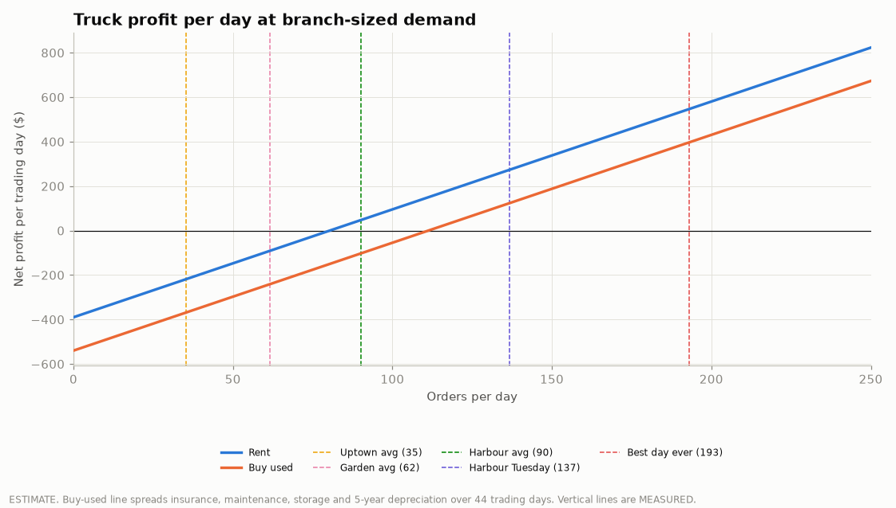
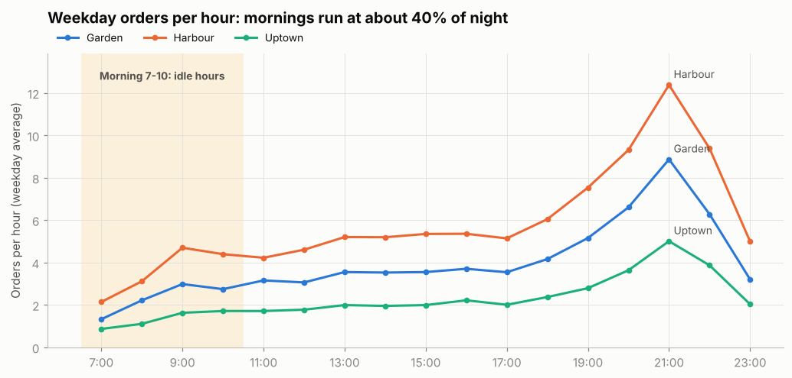
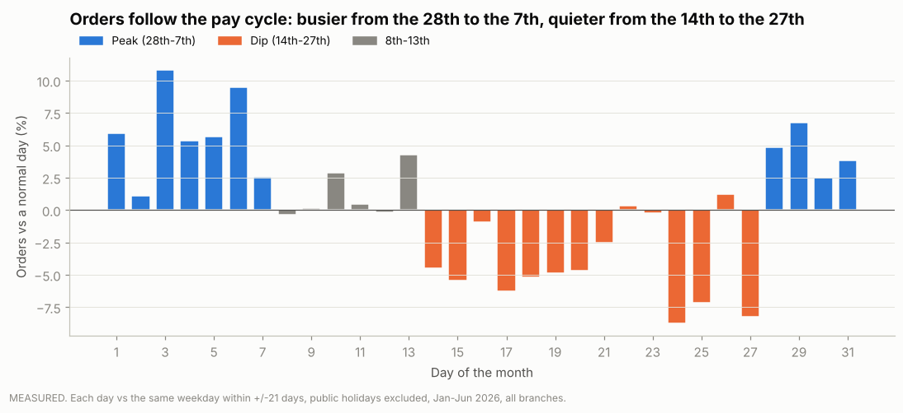

# Stories Coffee: Four Ways to Grow Profit

Hackathon project on Stories Coffee's Jan-Jun 2026 transaction data (3 branches: Garden,
Harbour, Uptown; 45 menu items; 33,887 orders).

## Executive summary

1. **Menu engineering per branch** ([full write-up](docs/menu_engineering.md)).
   53.8% of orders contain a single item, and profit per item varies more than 5x across the
   menu. Classifying every item per branch (Star / Plowhorse / Puzzle / Dog) and acting on it
   (push Stars, pair Plowhorses with Stars, rebrand Puzzles, merge Dogs) is worth an
   **estimated ~$32.8k of extra gross profit a year**, with no new customers. Each branch gets
   its own combos and a till rule built from its own sales (e.g. Uptown: drink alone →
   suggest a Chicken Pesto Sandwich; Garden: suggest a Butter Croissant), and a menu board
   that changes with the time of day (12 items change class between morning and night).
   Members repeat items exactly as often as random choice would (15.1% vs 15.3%), so their
   choices are not habits and can be steered by the menu and the till. Tested on
   unseen months, purchase-history models beat simple baselines only slightly, so the changes
   are proven with a **12-week switchback test at Harbour** (a design we checked on history:
   5.9% false alarms vs 40% for a simple before/after test).
   **Garden, the least profitable branch**, pays **43% more than Harbour for the same items**
   ($15.9k extra in six months, measured). Fixing its sourcing is worth an estimated
   **~$31.8k a year**; repricing alone can't fix it. A reorganized **Garden menu v2**
   (featured items that keep their margin, combos, sweets sold with drinks, Harbour-level
   prices on thin items) adds an estimated **$6.1k-$13.6k a year** on top.
2. **Should Stories go to the customer?** ([full write-up](docs/truck_business_case.md)).
   Branch revenue dipped **15.7% over Eid al-Fitr** 2026 (-$923, measured against the same
   weekday in nearby weeks) as customers spent the holiday with family. That raised a bigger
   question, tested from cheapest to most expensive: **Eid boxes + a limited-edition ma'amoul**
   (about 37 boxes of 6 replace the Eid profit gap), a **pop-up stand** at events, and a
   **truck**. At the demand Stories' own branches achieve (35-90 orders a day), renting a
   truck only breaks even at Harbour-like demand and **buying one does not pay back within
   two years**. Recommendation: boxes first, then one pop-up; rent a truck only if the pop-up
   proves 80+ orders a day.
3. **Filling the idle mornings** ([full write-up](docs/morning_offer.md), [sources](docs/morning_sources.md)).
   Every branch trades from 7:00, yet weekday mornings run at about **40% of the night pace**,
   and **65% of morning hot-coffee orders have no food**. Offer: a **"coffee + any pastry"
   bundle** (picked with the morning menu matrix) with a **loyalty card** (pays if 11% of users
   are new), a breakfast board, and free delivery **only on office packs via an own courier**
   (sourced courier cost $2-6: single-coffee delivery needs 43-130% new customers, i.e. it
   doesn't pay). Supply is feasible: +5 bundles a day adds 16-43% to bakery volume, within each
   branch's normal daily swing. Value is modest: **+5 orders per branch per office day ≈
   $2.9k-$9.2k a year** (estimate, depending on how many are new). The data shows no office
   pattern, so it is tested first: 12 weeks at Harbour on a metric checked against history.
4. **The payday cycle and a Month Pass** ([full write-up](docs/payday_month_pass.md)).
   Orders run **+5.1% from the 28th to the 7th** and **-4.1% from the 14th to the 27th**, in all
   6 months, all 3 branches, members and walk-ins (p < 0.001); ticket size doesn't change. Action
   1: move promotions into the mid-month dip (no cost). Action 2: a **Month Pass** (4 drinks for
   the price of 3.5, sold right after payday, free pastry for mid-month visits) breaks even at
   0.80 extra visits per pass; estimates range **-$1.2k to +$11.7k a year**, so it is proven
   first with a **randomized trial on the 607 regular members**.

**Measured vs estimated:** every number labelled *measured* comes straight from the data.
Every *estimate* is a measured input times a stated assumption, and the assumption is written
next to it.

## Data quality notes

- 132 exact duplicate rows removed (51,177 to 51,045 rows).
- Revenue and gross-profit formulas verified on every row (`src/clean.py`).
- 36.5% of orders have no Customer ID (walk-ins).
- The file contains product costs only: no labour, rent, waste or energy costs, so all profit
  figures are **gross** profit.

## Project 1: Menu engineering

| Output | File |
|---|---|
| Menu matrix per branch + chain | `outputs/tables/menu_matrix_*.csv`, `outputs/figures/matrix_*.png` |
| Items that change class between branches | `outputs/tables/class_differences.csv` |
| Action for every item at every branch | `outputs/tables/menu_actions.csv` |
| Four designed pairings with prices | `outputs/tables/designed_pairings.csv` |
| Money estimates with assumptions | `outputs/tables/money_estimates.csv`, `outputs/figures/money_estimates.png` |
| Pairing lift + model vs baseline | `outputs/tables/pair_lift_*.csv`, `outputs/tables/pairing_model_results.csv`, `outputs/figures/pairing_model.png` |
| Per-branch combos + till suggestions (from purchase history), tested on May-Jun | `outputs/tables/branch_combos.csv`, `outputs/tables/till_suggestions_by_branch.csv`, `outputs/tables/branch_combos_validation.csv`, `outputs/figures/branch_combos_validation.png` |
| Garden menu v2: reorganized board, new prices, impact in 3 scenarios | `outputs/figures/garden_menu_v2.png`, `outputs/tables/garden_menu_v2.csv`, `outputs/tables/garden_menu_impact.csv` |
| Time-of-day menu (12 items change class), time-of-day till rules tested on May-Jun, steerability test (members choose like random-by-popularity) | `outputs/tables/daypart_*.csv`, `outputs/tables/steerability.csv`, `outputs/figures/daypart_class_changes.png` |
| Garden case: cost leak, item actions, sourcing and repricing scenarios | `outputs/tables/garden_items.csv`, `outputs/tables/garden_scenarios.csv`, `outputs/tables/branch_kpis.csv`, `outputs/figures/garden_cost_leak.png`, `outputs/figures/garden_scenarios.png` |
| Test design checked on history (false alarms, detectable effect) | `outputs/tables/ab_test_power.csv`, `outputs/tables/ab_test_placebo.csv` |
| Evidence checks for every supporting fact quoted in the docs | `outputs/tables/evidence_checks.csv` |
| Leakage + stability validation | `menu_engineering/validate.py`, `outputs/tables/matrix_stability.csv` |


## Project 2: Reaching customers outside the branches

| Output | File |
|---|---|
| Holiday dips vs a local same-weekday baseline | `outputs/tables/eid_holiday_dips.csv`, `outputs/figures/eid_holiday_dips.png` |
| Eid boxes, limited edition, profit targets | `outputs/tables/eid_boxes.csv`, `outputs/tables/eid_box_targets.csv` |
| Truck menu economics | `outputs/tables/truck_menu.csv`, `outputs/tables/truck_menu_summary.csv` |
| Truck rent/buy scenarios at measured branch demand | `outputs/tables/truck_scenarios.csv`, `outputs/tables/truck_breakeven.csv`, `outputs/figures/truck_profit_per_day.png` |
| Boxes vs pop-up vs rent vs buy | `outputs/tables/truck_channel_comparison.csv`, `outputs/figures/truck_channel_comparison.png` |
| Holiday calendar, security notes, sources | `truck/holiday_calendar.csv`, `docs/truck_sources.md` |



## Project 3: Filling the idle mornings

| Output | File |
|---|---|
| Orders per hour by branch, morning facts | `outputs/tables/morning_orders_per_hour.csv`, `outputs/tables/morning_facts.csv`, `outputs/figures/morning_idle_hours.png` |
| Morning menu matrix, bundles and prices | `outputs/tables/morning_menu_matrix.csv`, `outputs/tables/morning_bundles.csv` |
| Loyalty vs delivery, scenarios, capacity | `outputs/tables/morning_channel_economics.csv`, `outputs/tables/morning_scenarios.csv`, `outputs/tables/morning_upsell_ceiling.csv`, `outputs/figures/morning_offer_economics.png` |
| Supply check: opening times, office days, stock needed, cost stability | `outputs/tables/morning_supply_check.csv`, `outputs/tables/morning_opening_evidence.csv`, `outputs/tables/morning_office_days.csv`, `outputs/tables/morning_cost_stability.csv`, `outputs/figures/morning_supply_check.png` |
| Test design checked on history | `outputs/tables/morning_test_design.csv` |



## Project 4: The payday cycle and a Month Pass

| Output | File |
|---|---|
| Day-of-month cycle, robustness, value of the dip | `outputs/tables/payday_by_day_of_month.csv`, `outputs/tables/payday_robustness.csv`, `outputs/tables/payday_dip_value.csv`, `outputs/figures/payday_cycle.png` |
| Member frequency, pass design, profit scenarios | `outputs/tables/month_pass_members.csv`, `outputs/tables/month_pass_visit_distribution.csv`, `outputs/tables/month_pass_design.csv`, `outputs/tables/month_pass_scenarios.csv`, `outputs/figures/month_pass_scenarios.png` |
| Randomized trial design | `outputs/tables/month_pass_test_design.csv` |



## How to run

```bash
pip install -r requirements.txt
python src/clean.py                         # clean data + integrity checks
python menu_engineering/menu_matrix.py      # Project 1: classify items per branch
python menu_engineering/actions.py          # Project 1: actions, pairings, money estimates
python menu_engineering/pairing_model.py    # Project 1: lift + model vs baseline
python menu_engineering/branch_combos.py    # Project 1: per-branch combos + till suggestions + test
python menu_engineering/daypart.py          # Project 1: time-of-day menu + steerability test
python menu_engineering/garden_case.py      # Project 1: Garden cost leak + options
python menu_engineering/garden_menu.py      # Project 1: Garden menu v2 (board, prices, impact)
python menu_engineering/ab_test_power.py    # Project 1: test design checked on history
python menu_engineering/evidence_checks.py  # Project 1: computes every supporting fact quoted in the docs
python menu_engineering/validate.py         # Project 1: leakage + stability checks (must print "All checks passed")
python truck/holiday_dips.py                # Project 2: holiday dips (local baseline)
python truck/truck_menu.py                  # Project 2: truck menu economics
python truck/eid_boxes.py                   # Project 2: Eid boxes + limited edition
python truck/truck_model.py                 # Project 2: rent/buy at measured demand
python truck/channel_comparison.py          # Project 2: boxes vs pop-up vs truck
python morning/morning_demand.py            # Project 3: idle mornings, who buys
python morning/morning_supply.py            # Project 3: opening times, office days, supply check
python morning/morning_offer.py             # Project 3: bundles, loyalty vs delivery, test
python payday/payday_cycle.py               # Project 4: day-of-month cycle
python payday/month_pass.py                 # Project 4: Month Pass economics + trial design
```

All scripts run from the repository root and write to `outputs/`.

## Repository structure

```
data/raw/stories_transactions.csv   raw export (private repo)
src/clean.py                        load_clean(): shared cleaning for both projects
src/style.py                        shared chart style
menu_engineering/                   Project 1 scripts
truck/                              Project 2 scripts and inputs
docs/menu_engineering.md            Project 1 write-up for the CEO
docs/truck_business_case.md         Project 2 write-up for the CEO
docs/truck_sources.md               Project 2 sources (holidays, security, costs, ma'amoul)
morning/                            Project 3 scripts
docs/morning_offer.md               Project 3 write-up for the CEO
docs/morning_sources.md             Project 3 sources (holidays, delivery costs, loyalty)
payday/                             Project 4 scripts
docs/payday_month_pass.md           Project 4 write-up for the CEO
outputs/tables, outputs/figures     generated results
```
