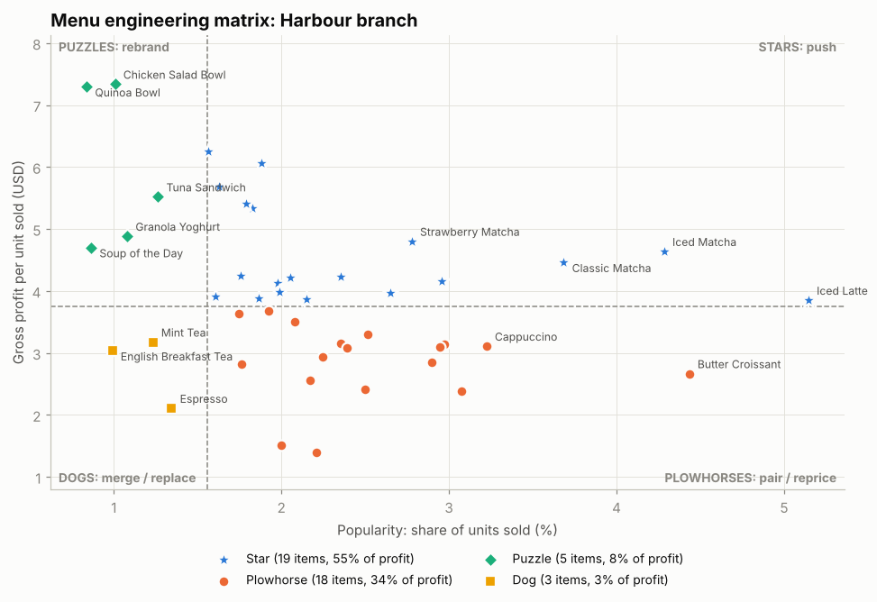
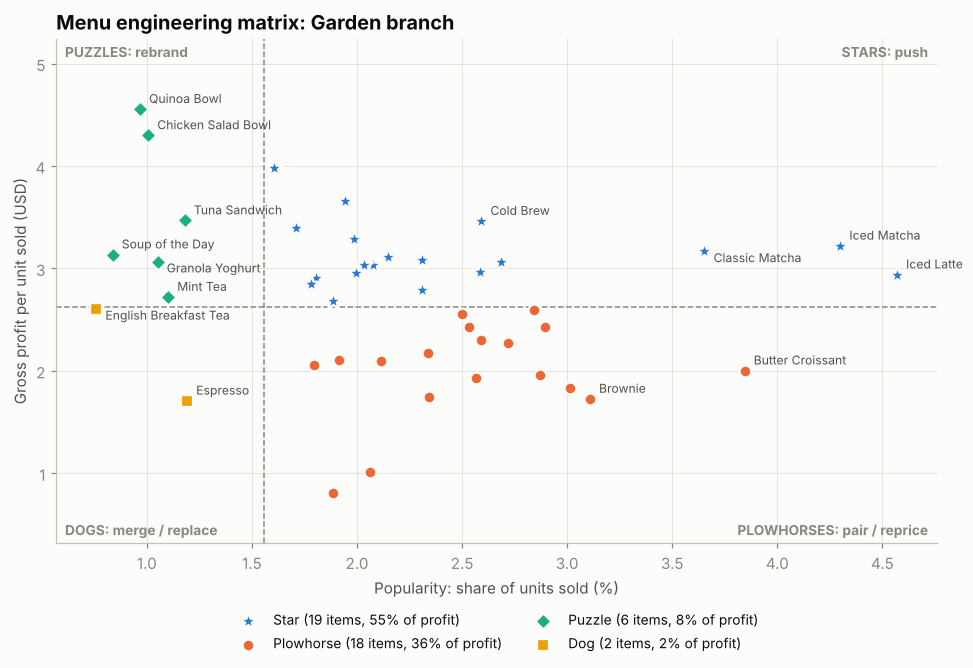
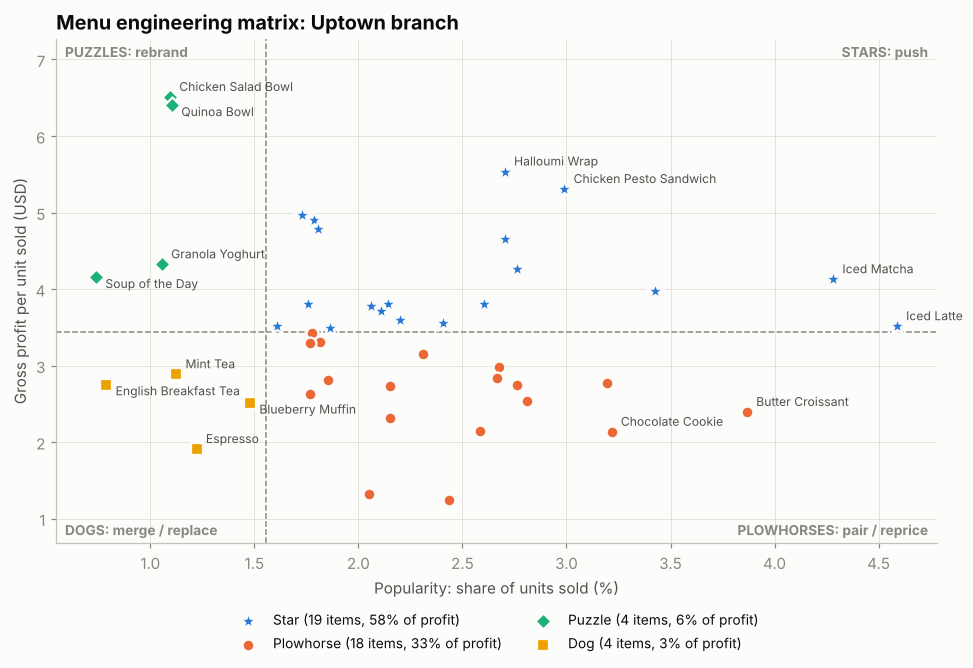
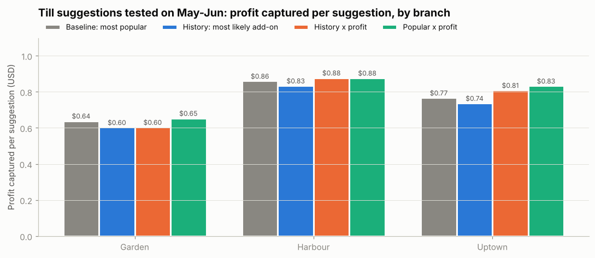
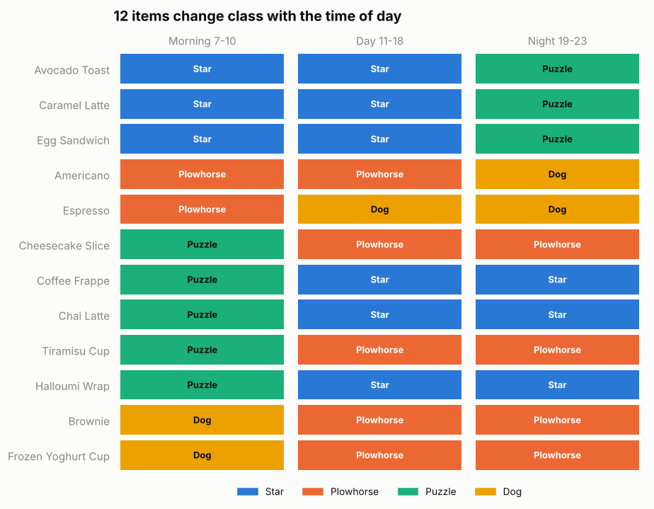
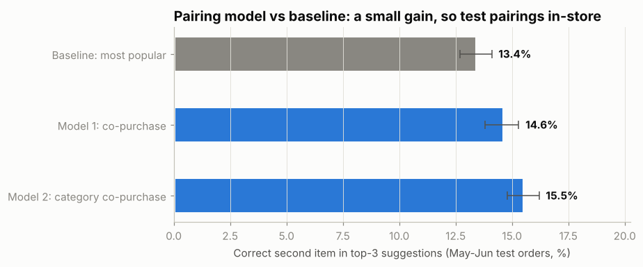
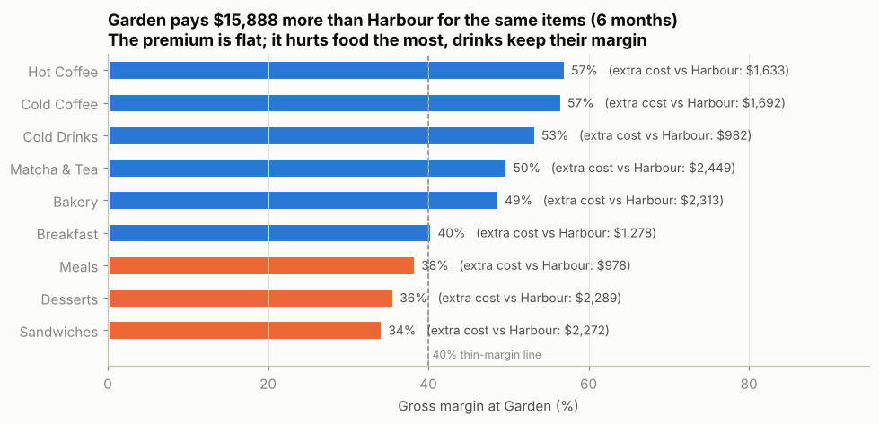
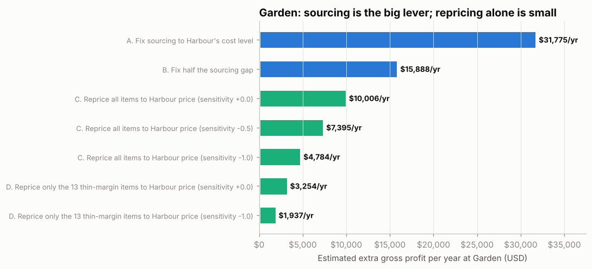
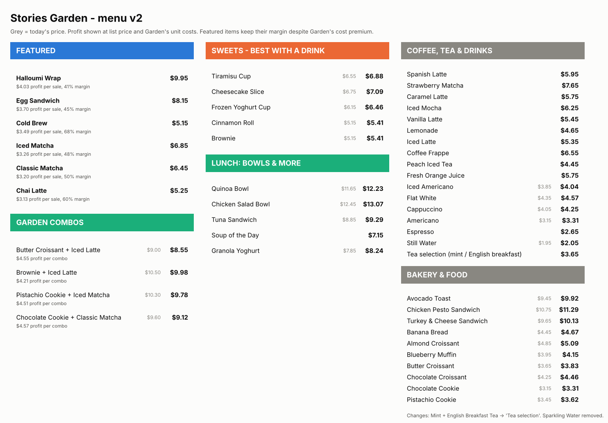

# Project 1: Menu Engineering per Branch

**Conclusion for the CEO:** run menu engineering *per branch*, not chain-wide. Push the Stars,
pair the low-profit best-sellers with them, rebrand the high-profit items nobody orders, and
merge the dead weight. Give every branch its own combos and its own till rule, built from
what that branch's customers buy. Estimated extra gross profit: **about $32,800 a year**,
with no new customers needed. Fix Garden's 43% cost premium (~$31.8k a year on its own), and prove the menu changes with a 12-week switchback test at Harbour.

> **Measured** = computed directly from the Jan-Jun 2026 transaction file (51,045 lines,
> 33,887 orders after removing 132 duplicate rows).
> **Estimated** = a measured input multiplied by a stated assumption. Every estimate below
> names its assumption.

---

## 1. The problem (measured)

| | Garden | Harbour | Uptown | Chain |
|---|---|---|---|---|
| Orders (6 months) | 11,163 | 16,334 | 6,390 | 33,887 |
| Gross profit per order | $4.18 | $5.97 | $5.45 | $5.28 |
| Orders with only **one item** | 53.3% | 53.9% | 54.5% | **53.8%** |
| Average profit per item sold | $2.62 | $3.75 | $3.43 | $3.32 |

- **More than half of all orders contain a single item.** A one-item order earns **$3.48**;
  a two-item order earns **$7.04**.
- **Profit per item varies more than 5x across the menu**: from about $1.24 (still water) to
  over $6 (bowls), yet the menu treats them all the same.
- **Each branch has different economics.** Garden pays about 49% more than Uptown for the
  same products, so an item that is a Star at Harbour can be a weak seller at Garden.
  8 items change class between branches (section 3).

## 2. Method

Standard menu engineering (Kasavana & Smith), applied separately to each branch:

- **Popular** if the item's share of units sold is at least 70% of an equal share:
  0.70 x (1 / 45 items) = **1.56%**.
- **Profitable** if its gross profit per unit is at least the branch's average
  (Garden **$2.62**, Harbour **$3.75**, Uptown **$3.43**).

| | Profitable | Not profitable |
|---|---|---|
| **Popular** | ⭐ **Star**: push | 🐴 **Plowhorse**: pair / reprice |
| **Not popular** | 🧩 **Puzzle**: rebrand | 🐕 **Dog**: merge / replace |

Why gross profit per unit and not margin %: margin % misleads. Mint Tea has an ~81% margin
but earns only ~$3 per cup and rarely sells; Iced Matcha earns more dollars per sale and
sells about 4x more. The business banks dollars, not percentages.

Code: [`menu_engineering/menu_matrix.py`](../menu_engineering/menu_matrix.py).

## 3. Results per branch (measured)

| Share of gross profit | Garden | Harbour | Uptown |
|---|---|---|---|
| ⭐ Stars | 54.7% (19 items) | 55.0% (19) | 57.5% (19) |
| 🐴 Plowhorses | 35.5% (18) | 34.4% (18) | 32.8% (18) |
| 🧩 Puzzles | 8.3% (6) | 8.0% (5) | 6.4% (4) |
| 🐕 Dogs | 1.5% (2) | 2.6% (3) | 3.3% (4) |

**8 items change class between branches**, so one chain-wide decision would be wrong
somewhere ([`class_differences.csv`](../outputs/menu_engineering/tables/class_differences.csv)):

| Item | Garden | Harbour | Uptown |
|---|---|---|---|
| Tiramisu Cup | Plowhorse | **Star** | **Star** |
| Cheesecake Slice | Plowhorse | **Star** | **Star** |
| Tuna Sandwich | Puzzle | Puzzle | **Star** |
| Lemonade | **Star** | Plowhorse | Plowhorse |
| Peach Iced Tea | **Star** | Plowhorse | Plowhorse |
| Fresh Orange Juice | **Star** | **Star** | Plowhorse |
| Mint Tea | Puzzle | Dog | Dog |
| Blueberry Muffin | Plowhorse | Plowhorse | Dog |

Why: Garden's product costs are ~49% above Uptown's for the same items while its prices are
only ~4% higher, which pushes its desserts down into Plowhorses. Uptown sells
sandwiches and wraps 1.3-1.5x more than the chain average, which lifts Tuna Sandwich into a Star
([`evidence_checks.csv`](../outputs/menu_engineering/tables/evidence_checks.csv)).

## 4. Actions

Full list per branch and item: [`outputs/menu_engineering/tables/menu_actions.csv`](../outputs/menu_engineering/tables/menu_actions.csv).

**⭐ Push the Stars (all branches):** Iced Matcha, Iced Latte, Classic Matcha, Cold Brew,
Strawberry Matcha, sandwiches and wraps. Top of the menu board, lead every pairing, never discount.

**🐴 Pair and reprice the Plowhorses:** croissants, cookies, brownies, cappuccino, water.
Pair each with a Star (below) and test **+$0.20**.

**🧩 Rebrand the Puzzles:** Chicken Salad Bowl and Quinoa Bowl earn **$7.32** per bowl at
Harbour and **$6.45** at Uptown, the most of anything on the menu, but rarely sell. Add photos,
move them to the top-right of the menu, and sell them as a lunch combo (11 am-3 pm).

**🐕 Dogs: merge, don't just delete** (they are only 1.5-3.3% of profit; removing them saves
menu space, not money):
- Merge **Mint Tea + English Breakfast Tea** into one "Tea selection" and suggest Chai Latte.
- Remove **Blueberry Muffin at Uptown only** (a Dog there, a Plowhorse elsewhere). Test 6 weeks.
- **Keep Espresso.** It is the base of the coffee menu; add a double-shot upsell instead.

**Branch-specific moves:**
- **Harbour & Uptown:** push Tiramisu and Cheesecake (Stars there).
- **Uptown:** sandwich-first menu board; Tuna Sandwich is a Star there.
- **Garden:** push Lemonade and Peach Iced Tea. **Fix sourcing before repricing desserts.**

### Four designed pairings (Star + Plowhorse, priced 5% below buying both)

| Pairing | Harbour bundle price | Bundle profit | Extra profit vs Star alone |
|---|---|---|---|
| Iced Latte + Butter Croissant | $8.98 | $6.18 | +$2.22 |
| Cold Brew + Brownie | $10.28 | $6.75 | +$2.50 |
| Chicken Pesto Sandwich + Peach Iced Tea | $15.16 | $8.84 | +$2.72 |
| Quinoa Bowl + Iced Matcha (lunch) | $18.45 | $11.02 | +$3.71 |

All three branches: [`designed_pairings.csv`](../outputs/menu_engineering/tables/designed_pairings.csv).

### Per-branch combos and till suggestions, from each branch's purchase history

Code: [`menu_engineering/branch_combos.py`](../menu_engineering/branch_combos.py).
Built **separately for each branch** from what that branch's customers actually bought
together (drink + food), and from each item's profit **at that branch**.

**Till rule (what staff suggest when a customer orders one item):**

| Branch | Customer orders a drink alone → suggest | Customer orders food alone → suggest |
|---|---|---|
| **Garden** | Butter Croissant (then Egg Sandwich, Chicken Pesto Sandwich) | Iced Matcha (then Iced Latte, Classic Matcha) |
| **Harbour** | Butter Croissant (then Chicken Pesto Sandwich, Halloumi Wrap) | Iced Matcha (then Iced Latte, Classic Matcha) |
| **Uptown** | **Chicken Pesto Sandwich** (then Halloumi Wrap, Turkey & Cheese) | Iced Matcha (then Iced Latte, Classic Matcha) |

Uptown is different because it is the sandwich branch: sandwiches sell 1.3-1.5x the chain
average there and earn $5.31 profit each. Full table, every item and its top-3 suggestions
per branch: [`till_suggestions_by_branch.csv`](../outputs/menu_engineering/tables/till_suggestions_by_branch.csv).

**Menu combos per branch** (pairs this branch's customers have already bought together at
least 15 times in six months, ranked by the profit they unlock from single-item orders;
priced 5% below buying both):

| Branch | Combo | Bought together (6 mo) | Bundle price | Bundle profit | Extra profit vs first item alone |
|---|---|---|---|---|---|
| Garden | Butter Croissant + Iced Latte | 33 | $8.55 | $4.55 | +$2.55 |
| Garden | Pistachio Cookie + Iced Matcha | 31 | $9.78 | $4.51 | +$2.76 |
| Garden | Chocolate Cookie + Classic Matcha | 34 | $9.12 | $4.57 | +$2.73 |
| Harbour | Butter Croissant + Iced Matcha | 63 | $10.47 | $6.82 | +$4.15 |
| Harbour | Cinnamon Roll + Strawberry Matcha | 38 | $12.77 | $7.35 | +$4.20 |
| Harbour | Iced Latte + Chicken Salad Bowl | 17 | $17.76 | $10.45 | +$6.60 |
| Uptown | Chocolate Croissant + Iced Matcha | 21 | $10.13 | $6.20 | +$3.66 |
| Uptown | Butter Croissant + Iced Matcha | 22 | $9.58 | $6.08 | +$3.68 |
| Uptown | Banana Bread + Classic Matcha | 16 | $9.94 | $6.25 | +$3.51 |

All combos (up to 6 per branch): [`branch_combos.csv`](../outputs/menu_engineering/tables/branch_combos.csv).

**How the till rule was chosen (tested, not assumed).** For each branch we learned from
Jan-Apr and tested on May-Jun drink + food orders (Garden 1,082, Harbour 1,615, Uptown 598).
Given the first item, is the real add-on in the top-3 suggestions, and how much profit do
the suggestions capture?

| Branch | Baseline: most popular | History: most likely add-on | History x profit | **Popular x profit** |
|---|---|---|---|---|
| Garden | $0.64 / suggestion | $0.60 | $0.60 | **$0.65** |
| Harbour | $0.86 | $0.83 | $0.88 | **$0.88** |
| Uptown | $0.77 | $0.74 | $0.81 | **$0.83** |

What this shows, honestly:
- **Item-to-item history does not beat "suggest what's popular"** at branch level: there
  are too few orders per branch for pair-specific patterns to be reliable (every 95%
  interval of the gain includes zero; see
  [`branch_combos_validation.csv`](../outputs/menu_engineering/tables/branch_combos_validation.csv)).
- **Weighting by profit captures slightly more profit per suggestion** (+$0.02 to +$0.07),
  even though customers accept it slightly less often. The gain is not yet statistically
  certain, so we use the **simplest method that did best: "popular at this branch x profit
  at this branch"**, and let the A/B test (section 8) confirm it.
- The result is a rule simple enough for staff to remember, and different per branch.

### Time of day: a different menu board for morning and evening

Code: [`menu_engineering/daypart.py`](../menu_engineering/daypart.py). The same matrix, run
separately for morning (7-10), day (11-18) and night (19-23):

**12 items change class with the time of day** (measured), and the result is stable:
86.7% (morning), 93.3% (day) and 95.6% (night) of items keep the same class between
Jan-Mar and Apr-Jun ([`daypart_stability.csv`](../outputs/menu_engineering/tables/daypart_stability.csv)).

| Menu board | Feature (Stars at that time) | Move down (weak at that time) |
|---|---|---|
| **Morning 7-10** | Egg Sandwich, Avocado Toast, Caramel Latte | Brownie, Frozen Yoghurt (Dogs in the morning) |
| **Day 11-18** | Halloumi Wrap, Chai Latte, Coffee Frappe | Espresso |
| **Night 19-23** | Halloumi Wrap, Chai Latte, Coffee Frappe; desserts in combos | Egg Sandwich, Avocado Toast, Americano |

Cost: a second board (or a screen) that switches at 11:00 and 19:00. This is the
"menu layout" change in the A/B test, now split by time of day.

**Should the till rule also change by time of day? Only at Harbour.** Tested on May-Jun
drink + food orders, a branch x time-of-day rule versus the branch rule
([`daypart_rule_validation.csv`](../outputs/menu_engineering/tables/daypart_rule_validation.csv)):

| Branch | Branch rule | Branch x time-of-day rule | Gain per suggestion (95% interval) |
|---|---|---|---|
| Harbour | $0.877 | **$0.920** | **+$0.043** (+$0.002 to +$0.081) |
| Garden | **$0.654** | $0.611 | -$0.043 (-$0.074 to -$0.010) |
| Uptown | $0.833 | $0.814 | -$0.019 (-$0.067 to +$0.031) |

Harbour has enough orders in each time slot for the finer rule to help; Garden and Uptown
do not, and splitting their data makes the suggestions worse. So: **Harbour uses the
time-of-day till rule** (drink alone → Avocado Toast in the morning, Chicken Pesto Sandwich
from 11:00; food alone → Vanilla Latte in the morning, Iced Latte by day, Iced Matcha at night);
**Garden and Uptown keep the branch rule.** Full list:
[`daypart_till_rules.csv`](../outputs/menu_engineering/tables/daypart_till_rules.csv).

## 5. Can the data pick the pairings for us? (model vs baseline)

We checked before guessing. Code: [`menu_engineering/pairing_model.py`](../menu_engineering/pairing_model.py).

**Lift** (1.0 = bought together exactly as often as chance) is weak everywhere:
the strongest product pair reaches only **1.23**, and bakery + coffee, the classic café
pairing, sits at **0.61-0.66** (customers combine them *less* than chance). The strongest
category pair is Sandwiches + Cold Drinks (**1.00**).

**Recommender test:** trained on Jan-Apr, tested on May-Jun orders it never saw (11,250
predictions from 2-item orders). Given one item, is the other in our top-3 suggestions?

| Method | Top-3 hit rate | 95% interval | Gain vs baseline (95% interval) |
|---|---|---|---|
| Baseline: 3 most popular items | 13.4% | 12.7-14.1% | — |
| Model 1: items bought with this item | 14.6% | 13.8-15.3% | +1.2 pts (+0.5 to +1.9) |
| **Model 2: items bought with this item's category** | **15.5%** | 14.8-16.2% | **+2.1 pts (+1.5 to +2.7)** |

Intervals are bootstrapped **by order** (5,625 test orders), so the two predictions from the
same order are never treated as independent.

**Conclusion:** the model beats the baseline (+16% relative; the gain's interval stays above zero), but
the absolute gain is small. Customers do not yet have strong pairing habits, so **the data
cannot pick winning pairings on its own.** Pairings must be **designed for profit** and
**proven with an in-store A/B test** (section 8). The model is still useful as a
till-suggestion fallback for items not in a designed pairing.

### Why history can't beat popularity: customers have no "usual" order

We tested whether members have habits. Each member's visits (3,494 members, median 6
visits, median **8 different items**) were checked for how often a visit includes an item
that member bought before. Then we simulated the same visits with items picked **at random,
weighted only by how popular each item is** ([`steerability.csv`](../outputs/menu_engineering/tables/steerability.csv)):

| | Visits that repeat an earlier item |
|---|---|
| Real members (measured) | **15.1%** |
| Random choice by popularity (20 simulations) | 15.3% (range 15.0-15.8%) |

**Members repeat items exactly as often as random choice would.** Their choices behave like
a pick from what is popular, not a personal habit. Two consequences:
1. It explains why the purchase-history models above could not beat "suggest what's
   popular": there is no individual pattern for them to learn.
2. **Demand is steerable.** Customers are not attached to "their" drink, so what the menu
   board shows first and what staff suggest has real room to change what they buy. That is
   the mechanism the whole menu-engineering plan relies on, and the A/B test measures it.

Caution: this shows choices are not habit-driven, not that a given suggestion will be
accepted. Acceptance is exactly what the switchback test measures.

### Validation: no data leakage, stable results

Code: [`menu_engineering/validate.py`](../menu_engineering/validate.py) (fails loudly if any check breaks).

| Check | Result |
|---|---|
| Time split | Train Jan 1-Apr 30 (9,445 multi-item orders), test May 1-Jun 30 (6,186). No date overlap |
| Shared transactions | 0 transactions in both sets; no transaction spans two dates |
| Leakage test | Model rebuilt from a copy of the data with May-Jun **deleted** gives **identical** test results |
| What the model uses | Only train-period counts + each product's category (fixed menu metadata, not learned) |
| Matrix stability | Classified on Jan-Mar, re-classified on Apr-Jun: **100%** of chain classes unchanged; 95.6-97.8% per branch |

Items that moved between halves (watch these in the quarterly re-run): Halloumi Wrap at
Garden and Harbour (on the Star/Puzzle line), Tiramisu Cup and Blueberry Muffin at Uptown.
The teas, Espresso and bowls keep their class in both halves, so those actions are robust.
Blueberry Muffin at Uptown was a Plowhorse in Jan-Mar and a Dog in Apr-Jun, so it is a
borderline case: that is why its removal is a 6-week test at Uptown only, not a permanent cut.

**What is *not* a trained model:** the menu matrix and money estimates are descriptive
calculations on the full six months, with no prediction involved. Their out-of-sample test
is the in-store A/B test in section 8.

## 6. Money (estimated)

| Lever | Measured input | Assumption | Extra gross profit / year |
|---|---|---|---|
| Pairing upsell | 18,237 single-item orders in 6 months; +$2.84 to +$4.02 profit when a second item is added (by branch) | 10% of single-item orders add a second item | **$12,998** |
| Puzzle push (bowls) | $7.32 (Harbour) / $6.45 (Uptown) profit per bowl | +2 bowls/day at Harbour and Uptown | **$10,053** |
| Plowhorse +$0.20 | 24,448 Plowhorse units in 6 months | sales volume unchanged | **$9,779** |
| **Total** | | | **$32,830** |

Assumptions can be changed at the top of [`menu_engineering/actions.py`](../menu_engineering/actions.py).
Sensitivity: at a 5% upsell conversion the total drops to ~$26k; at 15% it rises to ~$39k.

Not included: fixing Garden's product costs, a separate and larger lever (section 7).

## 7. The Garden case: the least profitable branch

Code: [`menu_engineering/garden_case.py`](../menu_engineering/garden_case.py).

| (6 months, measured) | Garden | Harbour | Uptown |
|---|---|---|---|
| Revenue | $99,531 | $150,099 | $55,554 |
| **Product cost** | **$52,834** | $52,596 | $20,759 |
| Gross margin | **46.9%** | 65.0% | 62.6% |
| Profit per order | **$4.18** | $5.97 | $5.45 |

**Garden spends as much on products as Harbour while selling a third less.**

**Diagnosis (measured):**
- For the **same item**, Garden's unit cost is **+43% above Harbour's** (+49% above Uptown's),
  on **every one of the 45 items** and in every month. The spread is extremely tight: +42.6% to +43.9%.
- That is **$15,888 of extra product cost in six months** compared with buying at Harbour's costs.
- A cost gap this uniform is not waste or portion size, which would differ item by item. It
  looks like a **different supplier price list, a transfer price, or overhead loaded into
  Garden's unit costs.** Only Stories' finance team can say which; that is the first question to ask.
- Garden's prices are actually **~5% below Harbour's**, so Garden pays more *and* charges less.

**Why it matters for the menu:** the premium is a percentage, so it hits **expensive-to-make
items hardest**. Sandwiches (34% margin), desserts (36%) and meals (38%) fall into thin
margins, while coffees (57%), cold drinks (53%) and matcha (50%) keep healthy margins. And
Garden's customers love desserts: they sell **1.2-1.3x the chain average** there
([`evidence_checks.csv`](../outputs/menu_engineering/tables/evidence_checks.csv)).

**Options for Garden (estimated, per year):**

| Option | Measured input | Assumption | Extra gross profit / year |
|---|---|---|---|
| **A. Fix sourcing to Harbour's cost level** | $15,888 extra cost in 6 months | Garden buys at Harbour's unit costs | **$31,775** |
| B. Fix half the sourcing gap | same | half the gap closed | $15,888 |
| C. Reprice everything to Harbour's prices (+~5%) | Garden ~5% below Harbour | volume holds / -0.5% / -1% per +1% price | $10,006 / $7,395 / $4,784 |
| D. Reprice only the 13 thin-margin items | 13 items under 40% margin | volume holds / -1% per +1% price | $3,254 / $1,937 |

**Repricing cannot fix Garden on its own.** Bringing the thin items back to a 50% margin would
need price rises of **+20% to +40%**, which customers would notice. The real fix is sourcing.

**The Garden plan:**
1. **This week, ask finance why Garden's unit costs are 43% higher than Harbour's** for
   identical items. If it is a supplier price list, move Garden onto Harbour's suppliers.
   If it is overhead loaded into unit cost, report it separately so menu decisions use true
   product costs.
2. **Steer the menu toward items that survive the premium.** Push Cold Brew (68% margin,
   $3.46 per sale), Iced Latte, Lemonade, Peach Iced Tea and Chai Latte. These are Stars at
   Garden. Lead every combo with them.
3. **Sell desserts and sandwiches through combos, not alone.** Garden's history-backed combos
   pair them with high-margin drinks: Pistachio Cookie + Iced Matcha ($4.51 profit),
   Chocolate Croissant + Iced Matcha ($4.70), Brownie + Iced Latte ($4.21).
4. **Garden till rule:** drink alone → suggest Butter Croissant; food alone → suggest Iced Matcha.
5. **Modest price move:** bring Garden to Harbour's prices (+~5%) only on the thin-margin
   food items first (option D), tested with the guardrails below.
6. **Sparkling Water** earns only $0.80 at Garden (29% margin): reprice to Harbour's price
   or drop it and let customers switch to Still Water or Lemonade.

Full per-item list with Garden actions: [`garden_items.csv`](../outputs/menu_engineering/tables/garden_items.csv).

### Garden menu v2: the reorganized board

Code: [`menu_engineering/garden_menu.py`](../menu_engineering/garden_menu.py). Built only from
Garden's own classes, unit costs and combos.

| Section | What goes there | Why |
|---|---|---|
| **Featured** (hero spots) | Halloumi Wrap, Egg Sandwich, Cold Brew, Iced Matcha, Classic Matcha, Chai Latte | Garden Stars that keep ≥40% margin despite the cost premium, top 6 by profit per sale ($3.13-$4.03) |
| **Garden combos** | Butter Croissant + Iced Latte, Brownie + Iced Latte, Pistachio Cookie + Iced Matcha, Chocolate Cookie + Classic Matcha | Garden's history-backed combos, $4.21-$4.57 profit each |
| **Sweets: best with a drink** | Tiramisu, Cheesecake, Frozen Yoghurt, Cinnamon Roll, Brownie | Thin margins (34-38%) at Garden: placed next to the combos, priced up to Harbour's level |
| **Lunch: bowls & more** | Quinoa Bowl, Chicken Salad Bowl, Tuna Sandwich, Soup, Granola Yoghurt | High profit per sale but rarely ordered: own section with photos |
| **Main menu** | Other drinks and food | Plowhorses priced up to Harbour's level (about +$0.15-0.25); Stars unchanged |
| **Changes** | Mint + English Breakfast Tea → "Tea selection"; Sparkling Water removed; Espresso kept | Sparkling Water earns $0.80 at Garden (29% margin) |

Per-item prices, old vs new profit per sale, and the reason for every move:
[`garden_menu_v2.csv`](../outputs/menu_engineering/tables/garden_menu_v2.csv).

**Estimated impact of the new menu (per year, Garden only):**

| Lever | Conservative | Central | Optimistic |
|---|---|---|---|
| Price moves (to Harbour's level) | $3,787 | $5,044 | $6,302 |
| Featuring (Plowhorse buyers moving to Featured items) | $640 | $1,066 | $1,706 |
| Combos + till upsell | $1,692 | $3,384 | $5,076 |
| Drop Sparkling Water | -$36 | $339 | $515 |
| **Total menu v2** | **$6,082** | **$9,834** | **$13,599** |
| Share of Garden's gross profit today | +6.5% | +10.5% | +14.6% |

Assumptions ([`garden_menu_impact.csv`](../outputs/menu_engineering/tables/garden_menu_impact.csv)):
conservative = each +1% price loses 1% of units, 3% of Plowhorse units move to Featured
items, 5% of single-item orders add an item; central = -0.5%, 5%, 10%; optimistic = no
volume loss, 8%, 15%. The featuring shift is plausible because members choose like
random-by-popularity (section 5), so placement on the board matters; its size is an
assumption the test will measure.

**Menu v2 is not a substitute for fixing sourcing.** The menu earns about $10k a year;
fixing the 43% cost premium is worth about $32k. Do both: sourcing first, menu alongside.
Once sourcing is fixed, re-run the Garden matrix. Desserts will likely become Stars again
and the "Sweets" section can move back to the main menu.

**Garden total:** sourcing fix (~$31.8k) + Garden menu v2 (central ~$9.8k, below) ≈
**$41.6k a year**, more than any other single branch action.

## 8. How to prove it: a test design checked against history

**We tested the test design first.** Using Jan-Jun 2026, when nothing was changed, any "effect"
a method finds is a false alarm. A trustworthy method should raise false alarms ~5% of the time.
Code: [`menu_engineering/ab_test_power.py`](../menu_engineering/ab_test_power.py).

| Design | False alarms on history | Smallest effect it can detect in 8 weeks / 12 weeks |
|---|---|---|
| Before vs after at Harbour (rejected) | **40%** (4 of 10 fake tests) | 4.9% / 4.0% |
| **Switchback: random ON / OFF days at Harbour** | **5.9%** (117 of 2,000 fake tests) | 6.0% / **4.9%** |

The simple before-vs-after test is **not trustworthy**: Harbour was already pulling ahead of
the other branches by about +0.2% a week, and Eid week hit Harbour differently, so it would
"prove" effects that do not exist. The switchback design compares ON and OFF days inside the
same weeks, so trends and holidays cancel out. Its false-alarm rate matches the expected 5%.
See [`ab_test_power.csv`](../outputs/menu_engineering/tables/ab_test_power.csv) and
[`ab_test_placebo.csv`](../outputs/menu_engineering/tables/ab_test_placebo.csv).

| | |
|---|---|
| **Where** | Harbour (largest branch, most orders per day) |
| **Design** | Switchback: each day randomly ON or OFF, half of each weekday ON |
| **ON days** | "Today's combos" card with Harbour's combos; staff follow Harbour's time-of-day till rule on every single-item order (section 4; e.g. after 11:00, drink alone → Chicken Pesto Sandwich) |
| **OFF days** | Normal service |
| **Always on** | New menu layout by time of day (morning and day/night boards, Stars first, bowl photos), since a printed menu can't switch daily |
| **Duration** | **12 weeks** to reliably detect +5% in profit per order (8 weeks only detects +6% or more) |
| **Main metric** | Gross profit per order, ON vs OFF days, relative to Garden + Uptown (Harbour now **$5.97**) |
| **Secondary** | Single-item order share (now 53.9%), bowls per day |
| **Guardrails** | Orders per day on ON days not more than 3% below OFF days |
| **Price changes** | Tested **separately** (prices can't switch daily): Plowhorse +$0.20 at one branch for 12 weeks, read with caution, since branch-level before/after comparisons drift |

**Staff script (Harbour, ON days):** morning: "Would you like an avocado toast with your
coffee?"; after 11:00: "Would you like a chicken pesto sandwich with that? It's a combo price
together." For a pastry ordered alone at night: "An iced matcha goes great with it, $10.47 for
both." When rolling out, Garden and Uptown use their branch rules (Uptown: drink alone →
Chicken Pesto Sandwich; Garden: drink alone → Butter Croissant).

**Decision at week 12:**
- Profit per order up on ON days, orders steady: **roll out** the combos and till rule to
  Uptown (sandwich-first version), then Garden (after its sourcing is fixed).
- No difference: stop the till rule; keep the menu layout. The cost of trying is close to zero.

Re-run the matrix **every quarter per branch**: items move between classes as costs and tastes change.

## 9. Limits and what's missing

- **Gross profit only.** The data has product costs but no labour, rent, waste or energy
  costs, so net profit gains will be smaller than gross.
- **Price response is unknown.** No prices changed during Jan-Jun 2026, so we cannot measure
  how customers react to +$0.20. That is exactly what the guardrails in the test are for.
- **Bundles shift some sales**: a customer who would have bought both items anyway now pays
  5% less. The test's profit-per-order metric captures this.
- **Six months of data** cover winter to early summer only.

## Approaches we rejected

- **Removing every Dog:** they are 1.5-3.3% of profit; removal only pays if customers switch
  to better items, and Espresso is core to the brand.
- **Chain-wide classification only:** it misclassifies 8 items for at least one branch.
- **A complex ML recommender:** the simple co-purchase model already shows the ceiling is low;
  a bigger model would not beat a designed, tested pairing.
- **Item-to-item history recommendations per branch:** tested on May-Jun, they did not beat
  the popular baseline (section 4), so the till rule uses branch popularity x profit instead.
- **Discount-led pairing promos:** Harbour's 15% promo (Mar 12-May 19) produced the same growth
  as Garden without a promo (+18.9% each; $471 of discounts given; see
  [`evidence_checks.csv`](../outputs/menu_engineering/tables/evidence_checks.csv)), so discounts alone did not move demand.
- **A time-of-day till rule at every branch:** it helped at Harbour but made Garden's
  suggestions worse (-$0.043 per suggestion), so it is used at Harbour only.
- **Takeaway vs dine-in menus:** profit per order ($5.27 vs $5.29) and single-item share
  (54.0% vs 53.7%) are the same, so no separate menu.
- **Chasing item trends:** the item mix did not change significantly between Jan-Feb and
  May-Jun (p = 0.17), so we do not claim any item is rising or falling.
- **A simple before-vs-after test:** on untouched history it raised false alarms 40% of the
  time; replaced by the switchback design (5.9%).
- **Fixing Garden by repricing alone:** thin items would need +20% to +40% price rises; the
  root cause is a uniform 43% cost premium, so sourcing comes first.
