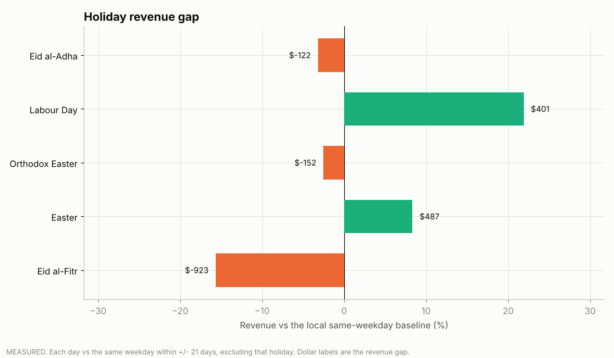
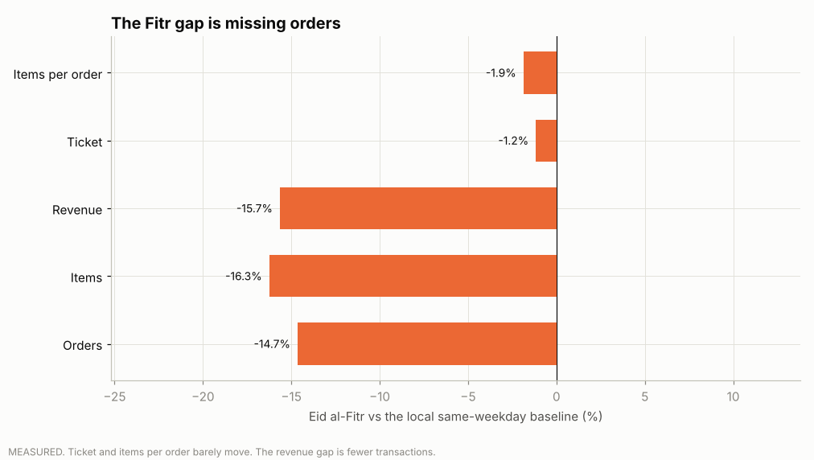
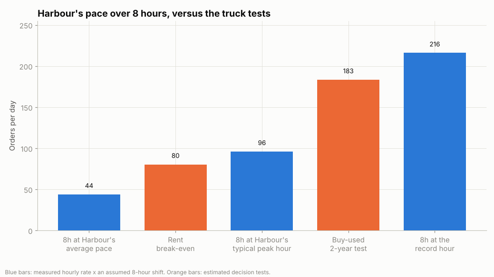
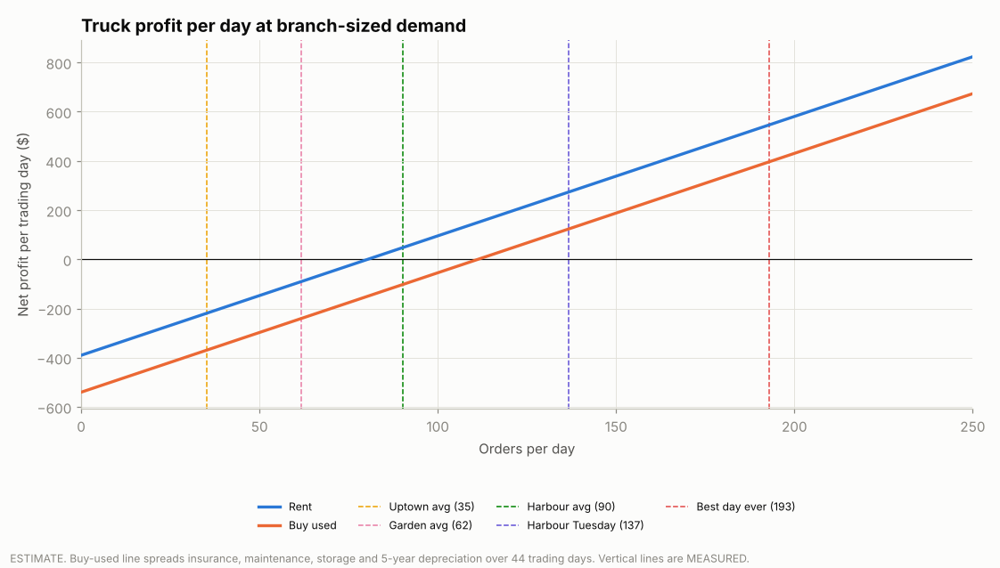
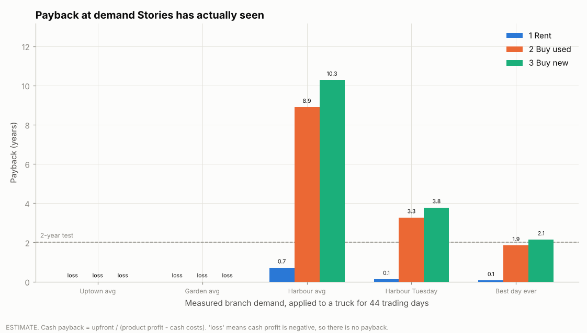
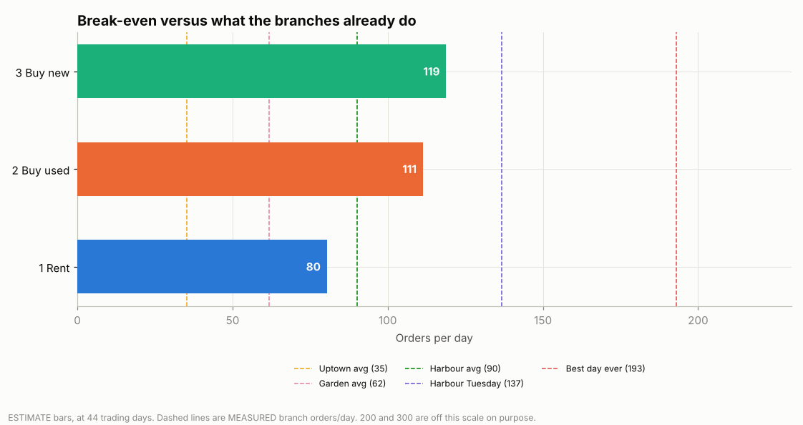
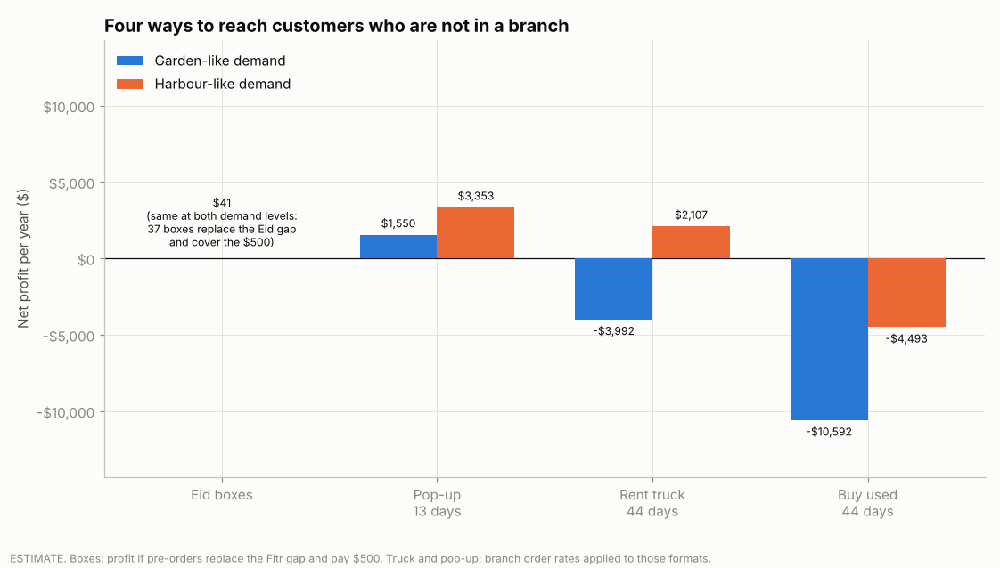

# Project 2: Should Stories go to the customer?

## 1. Conclusion

Start with Eid boxes and a limited-edition ma'amoul, then one pop-up stand. Rent a truck only if the pop-up holds about 80 orders a day. Do not buy a truck on this file: at Garden-sized demand it loses money, and even a Harbour-sized season does not pay a trailer back inside two years.

The Eid dip is how the question came up. It is not the size of the prize. Eid al-Fitr cost about **$923** of revenue. A used truck is **$51,300** before it sells anything.

> **Measured** = computed from `data/raw/stories_transactions.csv` (Jan-Jun 2026).
> **Estimated** = a measured input times a stated assumption, or a US list price. Every URL is in [2_truck_sources.md](2_truck_sources.md). Anything without one is marked **ASSUMPTION - verify locally**.

---

## 2. The observation

Branch sales dip on some holidays. The old write-up compared each Eid day with that weekday's average over all six months. That baseline is wrong: chain revenue grew **52.4%** from January to June, so a late-May day looked strong against a winter-heavy average.

The corrected baseline is local. For each holiday day, expected revenue is the average of the **same weekday within ±21 days**, and the holiday's own dates are left out of that average. Code: [`truck/holiday_dips.py`](../truck/holiday_dips.py).

| Holiday | Actual | Expected | Gap | Gross-profit gap |
|---|---|---|---|---|
| Eid al-Fitr, 20-23 Mar | $4,970 | $5,892 | **-$923 (-15.7%)** | -$533 |
| Orthodox Easter, 10-13 Apr | $5,893 | $6,045 | -$152 (-2.5%) | -$106 |
| Eid al-Adha, 27-28 May | $3,701 | $3,822 | **-$122 (-3.2%)** | -$40 |
| Easter, 3-6 Apr | $6,330 | $5,843 | +$487 (+8.3%) | +$262 |
| Labour Day, 1 May | $2,232 | $1,831 | +$401 (+21.9%) | +$275 |

21 Mar was the worst Fitr day, **$911**. It is the third-lowest day in the half-year (181 days). The lowest day overall was 17 Jan, at $830, and it was not a holiday.

Adha is a small dip, not a surge. The old "+13.5%, no dip" figure was the six-month weekday average.

The Fitr gap is missing orders, not a smaller basket. Against the same local baseline, orders were **-14.7%** (560 vs 656), items **-16.3%**, and revenue **-15.7%**. The ticket moved **-1.2%** ($8.87 vs $8.98) and items per order **-1.9%** (1.57 vs 1.60). Code: [`truck/dip_mechanism.py`](../truck/dip_mechanism.py).

Named customers do not prove that people left the city. Of identified customers in the prior 21 days, **10.0%** also bought on Fitr, against **11.5%** on the normal Friday-to-Monday of 6-9 March. And **36.5%** of lines have no customer id, so that check only covers the rest. The measured fact is fewer transactions. "They spent Eid in the villages" is still the hypothesis the boxes and the pop-up are there to test.

Chain context, measured: 33,887 orders, $305,184 revenue, $178,994 gross profit, 1.59 items per order, branches Garden, Harbour, and Uptown.

## 3. The question

Fitr is a measured dip of $923. The file does not say why. One hypothesis is that customers spend Eid away from the branches. The same dates also sit inside the war that started on 2 Mar, and they are the first days after Ramadan. Section 2 already rules out a smaller basket: orders fell 14.7%, the ticket fell 1.2%, and named customers came back at about the same rate as a normal weekend. That pattern fits people being away. It also fits a quieter weekend. Section 11 checks the other explanations the file can test (opening hours, the war in general). The boxes and the pop-up are how Stories tells the rest apart.

The question that is still worth answering either way: **should Stories go to its customers when they are not near a branch?**

Three answers, cheapest first. A pass on boxes proves people will pre-order. It does not prove they left the city.

## 4. Option 1: Eid boxes and a limited edition

Use pastries the branches already sell and that travel at room temperature. The mix is weighted by measured popularity times measured profit per unit.

**Box of 6:** one each of butter croissant, cinnamon roll, chocolate croissant, chocolate cookie, banana bread, almond croissant.

**Family box of 12:** two each of the first four, plus one banana bread, one almond croissant, one brownie, one pistachio cookie.

Price is the branch's list prices times **0.90** (a 10% box discount, an assumption). Cost is that branch's measured unit cost.

| Assembled at | Box of 6 price | Profit | Margin | Family box profit |
|---|---|---|---|---|
| Harbour | $24.09 | **$14.74** | 61.2% | **$28.76** |
| Uptown | $22.02 | $13.05 | 59.3% | $25.42 |
| Garden | $22.95 | $9.58 | 41.7% | $18.43 |

Garden's unit cost on these pastries is about **43%** above Harbour's, so a Garden box earns about **35%** less profit. Assemble at Harbour or Uptown.

The Fitr revenue gap is $923 (measured). Apply the chain's measured gross margin (58.7%) and the gross profit in that gap is about **$541** (estimate). Replacing it takes **37 Harbour boxes of 6**, or **19 family boxes**. A one-time **$500** for bags, cards, and a week of posts (assumption) needs **34 boxes of 6** or **18 family boxes** on its own. The go number is the higher of those two bars: **37 boxes of 6**, or **19 family boxes**. Those 37 already cover the $500 and leave about **$41**. The bar is 37, not 37 plus 34. That is a test, not a profit centre.

Limited edition, not in the file, all estimates, priced by analogy:

| Item | Priced like | Price | Profit |
|---|---|---|---|
| Ma'amoul (date, pistachio, or walnut) | Pistachio cookie | $3.51 | $2.17 |
| Pistachio baklava | Cinnamon roll | $5.24 | $2.73 |
| Rose-pistachio latte | Spanish latte | $6.06 | $3.81 |

Ma'amoul is the one product that serves both Eid and Easter. L'Orient Today records it as the Lebanese sweet for Easter and for both Eids. The same box can be offered again at Easter. Baklava and the rose-pistachio latte are seasonal add-ons with no Stories sales history.

A retail check, not a Stories cost: Hallab's international shop lists a box of 12 large pieces at **$36 pistachio ($3.00 each)**, **$28 walnut**, and **$24 date**. The $3.51 analogy sits next to a large pistachio piece. It is not the small Eid piece. Beirut.com's March 2024 phone survey put Hallab at **$22 / $17 / $15 per kilo** for pistachio, walnut, and date. Per-kilo prices are a different product size. Pick one size before printing a price.

How it sells: pre-order on WhatsApp or Instagram the week before Eid, pick up at any branch on the last days of Ramadan, and sell the limited edition in the branches during Eid week. Detail: [`outputs/truck/tables/eid_boxes.csv`](../outputs/truck/tables/eid_boxes.csv).

## 5. Option 2: a pop-up stand

One event, not a fleet. Beirut Holidays runs **16-28 Jul 2026** at Antelias-Naccache (13 days, from the calendar, sourced to Annahar).

Assumptions: a stand at **$100 a day**, two staff at **$40** each, a spare branch espresso machine at **$0**. Cash cost **$180 a day**. Break-even is **37 orders a day**, using the truck menu's estimated **$4.85** product profit per order. Uptown averages **35**, so a stand that only matches Uptown misses break-even by a little. Garden averages 62 and Harbour averages 90. If a stand did a whole branch's day, 13 days would net about **$1,550** at Garden's rate and **$3,350** at Harbour's. A festival stand is not a branch. Those two figures are a ceiling, not the forecast. Upfront is $0 in this model. Section 5 names the 2026 listing. The test to run is a 2027 date (section 9).

## 6. Option 3: a truck, at demand Stories has actually seen

The old 100 / 200 / 300 orders a day sit above any branch-day in the file. The scenarios now are measured:

| What the branches did | Orders per day |
|---|---|
| Uptown average | 35 |
| Garden average | 62 |
| Harbour average (busiest branch) | 90 |
| Harbour on Tuesdays | 137 |
| Best single branch-day in six months | 193 |

200 and 300 are labelled **STRETCH**. No Stories day has reached them.

A trading day, if the vehicle is owned: 2 x $40 staff + $40 fuel + $50 site + $30 misc = **$200**. Rent adds $150 for the vehicle and $40 for a generator: **$390**. Owned trucks also carry, per year, insurance $1,500, maintenance $2,000, storage $1,200, and straight-line depreciation over 5 years. Those four are assumptions. An unpaid travel day (staff + fuel, no sales) is in the model as a flag for trips outside Beirut. The numbers below leave it off.

Ticket **$7.50** and product profit **$4.85** per order are the truck menu (measured prices, times the measured 1.59 items per order).

At **44 trading days**:

| | Rent | Buy used | Buy new |
|---|---|---|---|
| Upfront | $1,500 | $51,300 | $59,299 |
| Break-even, orders/day | **80** | **111** | **119** |
| Net at Garden (62/day) | **-$3,992** | **-$10,592** | -$12,192 |
| Net at Harbour (90/day) | **+$2,107** | **-$4,493** | -$6,092 |
| Cash payback at Harbour | 0.7 years | 8.9 years | 10.3 years |

Renting at Garden-like demand loses money. At Harbour-like demand it is a small profit, about $2,100, close to break-even relative to the decision. Buying does not pay back within 2 years at Uptown, Garden, Harbour, or Harbour Tuesday. A used trailer needs about **183 orders a day** for 44 days to pay back in two years on a cash basis. That is above Harbour Tuesday and only just under the single best day the chain has ever had. Repeating that day all season is not a plan.

**What an 8-hour shift can hold.** Harbour averages **5.5 orders per open hour**. Its typical busiest hour is **12 orders**. The busiest hour in the whole file is **27 orders** (Harbour, 3 Mar, 21:00). An 8-hour shift is an assumption. At Harbour's average pace that shift is **44 orders**. At the typical peak, held all day, it is **96**. At the record hour, held all day, it is **216**, and that is a ceiling rather than a rota. The rent test (80) sits between the average pace and a peak-all-day. The buy test (183) sits above a peak-all-day and below the record-all-day. A truck with one machine has not been timed. These Harbour rates are the fastest the branches have already gone.

**Permits.** The model uses **$800**, the bottom of Zion's range. At the **$17,000** top of that same range the used trailer costs **$67,500** upfront. Harbour-like cash profit still takes **11.7 years** to repay. Even a season of best-days (193 orders) slips to **2.4 years** and misses the two-year test. A Lebanon quote can retire the buy option on its own. Staff at $40, truck hire at $150, and a stand at $100 are still assumptions.

## 7. The four options side by side

| | Upfront | Cost per trading day | Break-even | Net, Garden-like | Net, Harbour-like | Risk | What a pass proves |
|---|---|---|---|---|---|---|---|
| Eid boxes | $500 | $0 extra | 37 boxes of 6 | $41 | $41 | Low | People will pre-order a box |
| Pop-up, 13 days | $0 | $180 | 37 orders/day | $1,550 | $3,353 | Medium | Off-site demand can clear a cheap day |
| Rent a truck, 44 days | $1,500 | $390 | 80 orders/day | -$3,992 | $2,107 | High | A mobile shop can hold Harbour-sized demand |
| Buy used, 44 days | $51,300 | $307 cash | 111 orders/day | -$10,592 | -$4,493 | Highest | Nothing yet |

The box "net" is the same in both columns on purpose. Boxes are not sold at a branch's orders-per-day. The $41 is what 37 Harbour boxes leave after they replace the Fitr profit gap and cover the $500. The pop-up nets are the ceiling from section 5: a stand that sells as many orders as a whole branch.

Ranking, in the order to try them: **boxes, pop-up, rent, buy.**

## 8. Where and when

Full rows: [`truck/holiday_calendar.csv`](../truck/holiday_calendar.csv). Rule on every row: **no stop under an evacuation order or active strikes.** Follow official guidance that week. A ceasefire date is not a permit. Ashoura (26 Jun) stays off the plan. A commercial truck is not appropriate on a mourning day.

2026, sourced:

- War from **2 Mar**. A 10-day cessation of hostilities from **16 Apr**. Reuters' 17 Apr explainer says Israeli forces were not required to leave the South.
- Anadolu: families no longer gathered in southern border villages for Eid al-Adha.
- Annahar: Ehdeniyat skipped, Beiteddine cancelled, Baalbek postponing, Byblos uncertain, Beirut Holidays moved to Antelias-Naccache for 16-28 Jul.

Do not send anything to Nabatieh, Tyre, or Baalbek-Hermel. Saida and Chtaura/Zahle are the safer names in the Eid note, and they have **no traffic source**. Batroun, Byblos, Faraya, and the mountain villages are the same: low confidence until someone checks them. There is no URL for the claim that southerners still went home for Eid in earlier wars. It is not a reason to deploy.

## 9. How we know if it works

Each stage runs only if the one before it passed.

**Stage 1. Boxes at the next Eid al-Fitr and Eid al-Adha.** timeanddate's tentative 2027 dates are **10-11 Mar** (Fitr) and **17-18 May** (Adha). Other calendars put Fitr on 9 Mar and Adha on 16 May. Confirm the moon-sighting announcement before opening pre-orders. **Go** at **37 Harbour boxes of 6**, or **19 family boxes**. Packaging alone needs 34, and 37 already includes it. This file contains one Fitr, so another cut of March 2026 cannot confirm the result. A 2027 pass is the confirmation.

**Stage 2. One pop-up.** A 2027 summer event, not a 2026 festival that has already been cancelled. Measure orders per hour and per day. **Go** if the stand holds at least the rent break-even, about **80 orders a day**. Clearing the pop-up's own 37 is not enough to justify a truck.

**Stage 3. Rent a truck for one summer season (44 days).** **Go to a purchase** only if it averages the two-year cash-payback level: about **183 orders a day** for a used trailer, over those 44 days. Harbour Tuesday (137) is not that level.

Log every test day in [`truck/pilot_log.csv`](../truck/pilot_log.csv) (date, channel, orders, boxes, cash cost, waste). Then run `python truck/score_pilot.py`. The log is empty until the pilot. A family box counts as two boxes of 6, because its Harbour profit is about double.

Before any out-of-Beirut stop, check Google Maps Popular Times and traffic for Batroun, Byblos, Saida, and Chtaura/Zahle on past holiday weekends, and keep the screenshots. Until those exist, those towns stay assumptions.

## 10. Measured vs estimated

| Figure | Kind |
|---|---|
| Fitr -$923 (-15.7%); Adha -$122 (-3.2%); 21 Mar at $911, third-lowest day | Measured |
| Fitr orders -14.7%, ticket -1.2%; named-customer return 10.0% vs 11.5% on 6-9 Mar | Measured |
| Harbour 5.5 orders per open hour; typical peak hour 12; record hour 27 | Measured |
| 8-hour caps: 44 at Harbour's pace, 96 at a typical peak, 216 at the record hour | Estimate. The 8-hour shift is an assumption |
| Permit ceiling $17,000: used trailer $67,500, Harbour payback 11.7 years, best-day season 2.4 years | Estimate, using Zion's published top of range |
| Hallab large box $36 / $28 / $24; 2024 kilo prices $22 / $17 / $15 | Retail benchmark, not a Stories cost |
| January-to-June revenue growth, 52.4% | Measured |
| 35 / 62 / 90 / 137 / 193 orders per day | Measured branch rates, not truck rates |
| Box mixes, branch list prices, branch unit costs, Garden's 43% cost gap | Measured |
| 10% box discount, $500 packaging, $541 profit in the Fitr gap | Estimate |
| Ma'amoul, baklava, rose-pistachio latte | Estimate, priced like a measured item |
| $180 pop-up day, $390 rent day, $200 owned day | Estimate. Verify locally |
| $1,500 / $51,300 / $59,299 upfront; insurance, maintenance, storage, 5-year depreciation | Estimate. US list prices at the low end, plus assumptions |
| 18, 44, and 80 trading days | 18 and 44 are counts from the calendar; 80 is not a sourced count |
| 200 and 300 orders a day | Stretch. Above any recorded Stories day |

## 11. Challenging the conclusion

### What else could explain the Eid al-Fitr dip

Code: [`truck/fitr_alternatives.py`](../truck/fitr_alternatives.py)
([`fitr_alternative_checks.csv`](../outputs/truck/tables/fitr_alternative_checks.csv)).

| Explanation | Check | Result |
|---|---|---|
| Customers left Beirut for Eid (first explanation) | Not testable: no customer location in the file | Open |
| Branches opened shorter hours | First and last order of each Eid day vs the baseline days | **Ruled out.** First orders 7:05-8:08, last orders 23:51-23:58, as on normal days |
| The war (from 2 Mar) depressed everything | How many baseline days were also wartime | **Ruled out as the whole story.** 21 of the 24 comparison days were wartime too, and Eid still ran 15.7% below them |
| A war escalation just before Eid (strike on central Beirut, 18 Mar) | Separate the two | **Can't be separated** with one Eid in the file. Eid al-Adha, after the ceasefire, dipped only 3.2% |
| Customers came at different times of day | Share of orders by hour | No real shift (largest change 1.9 points in any hour) |
| Customers came but bought less | Orders vs basket ([`eid_dip_mechanism.csv`](../outputs/truck/tables/eid_dip_mechanism.csv)) | **Ruled out.** Orders -14.7%, ticket only -1.2%: the gap is fewer orders |
| Regular customers stopped coming | Named customers from the prior 21 days who also bought on Eid | **Not supported.** 10.0% on Eid vs 11.5% on a normal Fri-Mon (6-9 Mar); covers the 63.5% of lines with an ID only |

So the dip is real: fewer orders, not smaller baskets, and not an opening-hours or
general-war effect. **Why** there were fewer orders is not proven. That is one more reason to start with boxes: a pre-order test
asks customers directly whether they want Stories when they are away from a branch.

### Assumptions that would change the decision

| Assumption | Value used | What changes the decision |
|---|---|---|
| Box pre-orders | Go at 37 Harbour boxes of 6 (they replace the Eid gap and cover the $500) | Under 37 boxes: stop at boxes; no pop-up |
| Pop-up demand | Break-even 37 orders a day | Under 37: no truck either |
| Truck demand | Rent break-even ~80 orders a day | Under 80 at the pop-up: don't rent |
| Rent cost (US rate) | $150 a day + $40 generator | Each $50 a day cheaper lowers the rent break-even by about 10 orders a day ($50 / $4.85 profit per order) |
| Product profit per truck order | $4.85 (truck menu, 1.59 items per order as in branches) | If a truck sells only drinks (~1 item), break-evens rise by about 60% |
| Buying | 2-year payback needs ~183 orders a day; permits at $800 | Only the best day on record (193) comes close. At a $17,000 permit even a season of best days takes 2.4 years: no purchase on this file |
| Staff cost | $40 a person a day | Higher wages push the rent break-even (80) toward the 96 orders an 8-hour peak can hold: then stop after the pop-up |

## 12. Risks and what the file does not contain

- **Security.** The South and Baalbek stay out. See section 8.
- **The dip is small, and the cause is untested.** A bad Fitr is under $1,000 of revenue. It cannot pay for a trailer. The missing money is fewer orders. Tickets barely moved, and identified customers came back at about the same rate as a normal weekend. The war from 2 Mar and the end of Ramadan fall on the same dates. This file has one Fitr, so the dip cannot be checked on a second holiday inside it.
- **What flips the action.** A permit quote near $17,000 makes buying miss two years even at a season of best days (2.4 years). If two staff cost more than $40 each, rent break-even rises from 80 and can pass the 96-order peak-all-day cap. Then stop after the pop-up. If the pop-up stays under 80 orders a day, do not rent.
- **A truck has not been timed.** The 8-hour caps use Harbour's hours. One machine and two people may be slower.
- **Permits.** $800 is the bottom of a US range that runs past $17,000. A Lebanese permit stack is not in the sources.
- **Wages, fuel, municipality fees, insurance, storage.** Not in the transaction file.
- **Cannibalisation.** Low if the customer was not going to a Beirut branch that day. The file cannot see that. Adha is the warning: the branches barely moved.
- **Travel days.** A trip outside Beirut costs a second day of staff and fuel with no sales. The tables above do not include it. Turn the flag on in `truck/truck_model.py` before pricing a Bekaa or coastal weekend.
- **Demand transfer.** Applying Harbour's 90 orders to a lay-by is an assumption, not a forecast.

## 13. Approaches rejected

- Buying a truck now.
- Pitching the truck as the fix for Eid. The hole is $923. The trailer is $51,300.
- Treating "customers left Beirut" as a measured cause. The file shows fewer orders.
- Adding the 37-box profit bar to the 34-box packaging bar. The go number is 37.
- Planning on 100, 200, or 300 orders a day. Stories has not had a branch-day that high. The best day was 193, once.
- The old six-month weekday baseline. It hid the Adha dip and flattered late spring.
- Deep-south deployment, Baalbek while its festival is postponing, Ehden or Beiteddine as 2026 festival stops, Easter 2026 (those dates were inside the war), and Ashoura.
