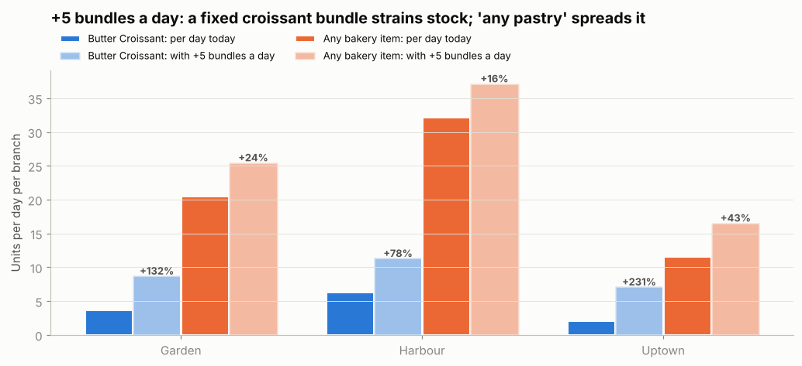
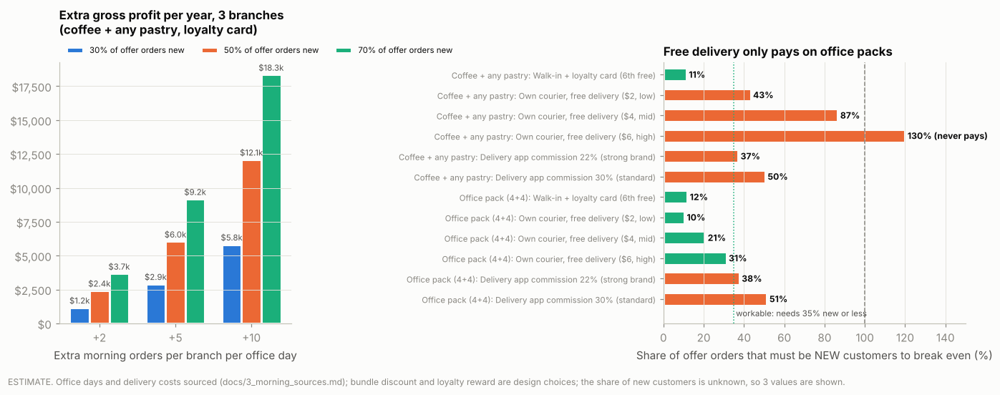

# Project 3: Filling the idle mornings

**Conclusion for the CEO:** every branch trades from 7:00, yet weekday mornings run at about
40% of the night pace. Launch a **"coffee + any pastry" morning bundle with a loyalty card**
(6th free) and a **breakfast board**, offer **free delivery only on office packs via your own
courier**, and test for 12 weeks at Harbour. The branches can supply it: a flexible bundle
adds 16-43% to bakery volume at +5 orders a day, within each branch's normal day-to-day
swing. Value is modest and depends on how many offer customers are new: **+5 orders per
branch per office day ≈ $2.9k-$9.2k gross profit a year** (estimate). The data shows no
office pattern in mornings, so office demand is something the test must prove.

> Every number below is **MEASURED** (computed from the transaction file), **SOURCED** (see
> [3_morning_sources.md](3_morning_sources.md)), a **DESIGN** choice, or an **ASSUMPTION** shown as
> a range. The evidence table in section 8 maps each claim to the file that produces it.

---

## 1. The problem: open and staffed, but idle (measured)

| Branch | Weekday orders/hour 7-10 | 7-11 pm | Morning as % of night | Morning orders/day now |
|---|---|---|---|---|
| Harbour | 3.59 | 8.72 | 41% | 14.3 |
| Garden | 2.32 | 6.02 | 38% | 9.3 |
| Uptown | 1.33 | 3.47 | 38% | 5.3 |

**The branches are open in the morning:** all three traded on all 181 days, the first order
comes at 7:00 at the earliest, median 7:24 (Harbour), 7:32 (Garden), 7:50 (Uptown)
([`morning_opening_evidence.csv`](../outputs/morning/tables/morning_opening_evidence.csv)). So the
morning team is already on shift; the data has no staff schedules or wages, so how idle they
are is not measured.

## 2. What morning customers do (measured)

| Fact | Morning | Night |
|---|---|---|
| Hot coffee share of items | **23.7%** | 11.2% |
| Takeaway share of orders | **54.0%** | 27.7% |
| Morning hot-coffee orders with **no food** | **64.7%** of 1,560 | |
| Members with at least one morning visit | 57.4% | |
| Members with 3+ morning visits | **5.2%** | |

Mornings are a grab-and-go hot-coffee moment, two in three coffee orders leave without food,
and mornings are an occasional habit, which is what a loyalty card is designed to build
([`morning_facts.csv`](../outputs/morning/tables/morning_facts.csv)).

**What the data does not show: an office crowd.** Mornings are 13.2-14.8% of orders on
every day of the week, weekends included, and morning takeaway is 54.0% on weekdays and
weekends alike. Offices are a hypothesis for the test, not a finding.

## 3. The bundles, chosen with the morning menu matrix

Menu matrix on 7-10 am sales only ([`morning_menu_matrix.csv`](../outputs/morning/tables/morning_menu_matrix.csv)):
morning Stars are **Vanilla Latte, Spanish Latte, Caramel Latte, Egg Sandwich, Avocado
Toast**; the most popular morning item is **Butter Croissant**; Granola Yoghurt is a
morning Puzzle. The most-bought morning pair is Flat White + Butter Croissant.

| Bundle | Items | Harbour | Garden | Uptown |
|---|---|---|---|---|
| **Coffee + any pastry** (main offer) | any hot coffee + any bakery item, priced at each branch's morning mix | $8.20, **$5.37 profit** | $7.79, $3.77 | $7.36, $4.72 |
| Quick morning (featured example) | Vanilla Latte + Butter Croissant | $8.60, $5.74 | $8.19, $4.10 | $7.86, $5.12 |
| Office breakfast | Spanish Latte + Egg Sandwich (two morning Stars) | $13.33, $8.24 | $12.69, $5.41 | $12.18, $7.29 |
| Office pack (4+4) | 4 hot coffees + 4 pastries | $34.49, $22.33 | $32.85, $15.47 | $31.53, $19.86 |

10% below buying separately (DESIGN) ([`morning_bundles.csv`](../outputs/morning/tables/morning_bundles.csv)).
Garden earns less on every bundle because of its 43% product-cost premium (Project 1).

**Breakfast board 7-10 am:** lead with Egg Sandwich, Avocado Toast (morning Stars, $4.68-$4.76
profit) and Granola Yoghurt (morning Puzzle, $4.24), next to the bundles.

## 4. Supply chain: can the branches deliver it? (measured)

Code: [`morning/morning_supply.py`](../morning/morning_supply.py),
[`morning_supply_check.csv`](../outputs/morning/tables/morning_supply_check.csv).

**A fixed-item bundle would strain stock.** The bundle items are small sellers today:

| Item | Units per day, all day (Garden / Harbour / Uptown) | Sold 7-10 on % of days | Extra stock needed at +5 bundles a day |
|---|---|---|---|
| Butter Croissant | 3.8 / 6.4 / 2.2 | 49% / 65% / 33% | **+132% / +78% / +231%** |
| Egg Sandwich | 1.9 / 2.6 / 1.0 | 33% / 38% / 24% | **+262% / +195% / +495%** |

**A flexible "coffee + any pastry" bundle does not:**

| Category | Units per day (G / H / U) | Sold 7-10 on % of days | Extra at +5 a day | vs normal daily swing |
|---|---|---|---|---|
| Any bakery item | 20.5 / 32.2 / 11.6 | 95% / 98% / 82% | **+24% / +16% / +43%** | 0.7 / 0.5 / 1.0 SD |
| Any hot coffee | 15.2 / 23.3 / 8.9 | 94% / 96% / 76% | +33% / +21% / +56% | 0.8 / 0.5 / 1.2 SD |

+5 bundles a day is about one normal day-to-day swing in bakery sales (0.5-1.0 standard
deviations), which today's ordering already absorbs. **No new supplier, product or equipment
is needed**: every bundle item is already sold at every branch.

| Supply question | Evidence |
|---|---|
| Cost predictability | All 135 branch x item unit costs stayed **exactly the same** Jan-Jun (0.0% change) ([`morning_cost_stability.csv`](../outputs/morning/tables/morning_cost_stability.csv)) |
| Prep | Coffees: espresso bar, made to order. Pastries: ready to sell. Egg Sandwich: assembled; keep it to the Office breakfast and pre-orders |
| Waste risk | Pastries are sold same day; **office packs are pre-ordered the day before**, so their stock is known in advance |
| Delivery | No delivery data exists; costs are sourced ranges (section 5) |

## 5. Loyalty card vs free delivery (estimate, sourced costs)

The question per channel: **what share of offer orders must be genuinely new customers for
it to break even?** (Rewards paid to customers who would have come anyway are the cost.)

| Bundle | Channel | Cost per order | Must be new |
|---|---|---|---|
| Coffee + any pastry | **Walk-in + loyalty card (6th free)** | $0.53 | **11%** |
| Coffee + any pastry | Own courier, free delivery ($2 / $4 / $6) | $2 / $4 / $6 | 43% / 87% / **never** |
| Coffee + any pastry | Delivery app (22% / 30% commission) | $1.71 / $2.33 | 37% / 50% |
| Office pack (4+4) | **Own courier, free delivery ($2 / $4 / $6)** | $2 / $4 / $6 | **10% / 21% / 31%** |
| Office pack (4+4) | Delivery app (22% / 30% commission) | $7.25 / $9.89 | 38% / 51% |

Courier cost $2-6 per delivery and app commission 22-30% are sourced (Voxire, May 2026).
Full table: [`morning_channel_economics.csv`](../outputs/morning/tables/morning_channel_economics.csv).

**Rules that follow:** a loyalty card for everyone; free delivery **only on office packs**,
**only through your own courier**, first 3 orders; no free delivery on single bundles; no
delivery apps for the morning offer.

## 6. What it could be worth (estimate)

Selling the bundle only to today's coffee-only morning customers is small: about **$300-900
a year** ([`morning_upsell_ceiling.csv`](../outputs/morning/tables/morning_upsell_ceiling.csv)). The value
has to come from **new** morning orders:

| Extra orders per branch per office day | 30% of offer orders new | 50% new | 70% new | Morning orders increase (H / G / U) |
|---|---|---|---|---|
| +2 | $1.2k | $2.4k | $3.7k | +14% / +22% / +38% |
| +5 | $2.9k | **$6.0k** | $9.2k | +35% / +54% / +94% |
| +10 | $5.8k | $12.1k | $18.3k | +70% / +108% / +188% |

Gross profit per year, 3 branches, coffee + any pastry, loyalty cost included, 226 office
days (from HolidayDB) ([`morning_scenarios.csv`](../outputs/morning/tables/morning_scenarios.csv)).
+10 a day would push Uptown above its own night pace (3.8 vs 3.5 orders an hour).

**Honest read:** this is a smaller lever than Garden's sourcing (~$32k) or menu engineering
(~$33k). Its case is low cost and low risk: no new products, suppliers or equipment, and the
loyalty card also captures customer IDs (36.5% of orders are anonymous today).

## 7. How to test it (design checked on history)

| | |
|---|---|
| **Where** | Harbour (most morning orders) |
| **What** | Coffee + any pastry bundle, Office breakfast, breakfast board 7-10, loyalty card; office-pack delivery via own courier, first 3 free |
| **Control** | Garden and Uptown, no changes |
| **Main metric** | Harbour's morning share of daily orders minus the controls' (Harbour now 14.4%) |
| **Duration** | 12 weeks |
| **Also track** | Loyalty sign-ups and redemptions (new vs existing IDs), office-pack orders, bakery waste per day |

On Jan-Jun history the weekly morning-share gap has **no drift** (+0.02 pts per week), and a
before/after test raised 1 false alarm in 10 fake 8-week tests. Over 12 weeks it detects a
**2.0-point** rise, about **+2 morning orders a day at Harbour**, the smallest scenario above
([`morning_test_design.csv`](../outputs/morning/tables/morning_test_design.csv)). Only 10 fake tests fit in
six months of data, so the false-alarm estimate is rough.

**Decision at week 12:** morning share up 2+ points and most loyalty redemptions from new IDs
→ roll out (Garden after its sourcing fix). Up, but delivery mostly to existing regulars →
keep bundle and card, drop delivery. No change → stop; for Uptown (under 1 order an hour at
7-8 am), consider opening at 9.

## 8. Evidence table: every claim and where it comes from

| Claim | Type | Source |
|---|---|---|
| Mornings run at 38-41% of the night pace | MEASURED | `morning_facts.csv`, `morning_orders_per_hour.csv` |
| All branches trade from 7:00 every day | MEASURED | `morning_opening_evidence.csv` |
| Hot coffee 23.7%, takeaway 54%, 64.7% of coffee orders without food | MEASURED | `morning_facts.csv` |
| No office / weekday signal in mornings | MEASURED | `morning_facts.csv` |
| Morning Stars, most popular morning item | MEASURED | `morning_menu_matrix.csv` |
| Bundle prices and profit per branch | MEASURED prices and costs, DESIGN 10% discount | `morning_bundles.csv` |
| Stock increase and daily swing | MEASURED | `morning_supply_check.csv` |
| Unit costs unchanged Jan-Jun | MEASURED | `morning_cost_stability.csv` |
| 226 office days a year | MEASURED calendar + SOURCED holidays | `morning_office_days.csv`, HolidayDB |
| Courier $2-6 per delivery, apps 22-30% | SOURCED | Voxire (May 2026) |
| 6th-free loyalty card | DESIGN (free item is the most common reward: Square) | Square (Feb 2024) |
| Share of offer orders that are new | ASSUMPTION, shown as 30/50/70% | `morning_scenarios.csv` |
| Test can detect +2 morning orders a day | MEASURED on history | `morning_test_design.csv` |
| 36.5% of orders anonymous | MEASURED | `evidence_checks.csv` |

## 9. Challenging the conclusion

### Why are mornings quiet? First explanation vs others

| Explanation | Check | Result |
|---|---|---|
| Nearby offices don't have a reason to come (first explanation) | Do weekday mornings look different from weekend mornings? | **Not supported.** Mornings are 13.2-14.8% of orders on every day of the week, and takeaway is 54% on weekdays and weekends alike |
| The branches open late or irregularly | First order of the day | **Ruled out.** All three traded on all 181 days from about 7:00 |
| Morning demand is simply small in Beirut (an evening café culture) | Can't be tested in this file | **Open.** If true, a bundle discounts existing customers and creates little; that is why value is shown at 30-70% new customers and why the test tracks new loyalty IDs |
| Customers would buy food but nothing suits them | 65% of morning coffee orders have no food, but bakery sells on 82-98% of mornings | Partly: food is available and bought; the bundle tests whether a price nudge adds it |

### Assumptions that would change the decision

Computed by [`morning/decision_thresholds.py`](../morning/decision_thresholds.py)
([`decision_thresholds.csv`](../outputs/morning/tables/decision_thresholds.csv)):

| Lever | Assumption in the estimate | Break-even value | If reality is worse |
|---|---|---|---|
| Loyalty card | 30-70% of bundle orders are new customers | **11% new** | Drop the card, keep the bundle |
| Staffing | Today's morning team handles the extra orders | One extra $40 shift needs **+18 orders a day at Harbour** (+126%), +33 at Garden, +21 at Uptown | If the offer needs an extra person, it does not pay: run it with today's team only |
| Office-pack delivery | Courier $2-6 a trip (sourced) | **$9.61 a trip** makes it need 50% new customers | Above that, no free delivery |
| Single-bundle delivery | Courier $2-6 a trip | Would need **$1.39 a trip** to pay at 30% new | Stays rejected |

The staffing line is the one that matters most: the offer only works if it uses spare time the
morning team already has. The file has no staff schedules, so operations must confirm this
before the test.

### What could go wrong in practice

- **The bundle mostly discounts customers who already buy coffee and a pastry.** The test
  tracks loyalty redemptions by new vs existing IDs; if most are existing, stop.
- **Bakery waste rises** if stock is raised for demand that doesn't come. Raise stock only
  after a week of bundle sales, and track waste per day.
- **Morning rush slows service** at Harbour. Track orders per hour 7-10; the bundle uses
  ready-to-sell pastries to keep prep time flat.

## 10. Limits

- **No customer type, location or staff data.** Office demand and spare staff time are not
  measured; the test measures the first, operations must confirm the second.
- **Delivery costs** come from a secondary source; get a courier quote before launch.
- **Jul-Dec public holidays** are assumed similar to Jan-Jun for the 226 office days.
- **New vs existing customers** is unknown today, which is why results are shown at 30/50/70%
  and why the loyalty card (which records IDs) is part of the test.
- **Information Stories could provide:** morning staff schedules (is there spare time?),
  bakery waste per day, a courier quote, and which branches have offices nearby.

## 11. Approaches rejected

- **Fixed-item bundles as the main offer:** +5 a day would need 2-5x today's croissant or egg
  sandwich stock at some branches; the flexible bundle needs +16-43%.
- **Free delivery on single bundles:** at the mid courier cost ($4) it needs 87% new customers;
  at $6 it never pays.
- **Delivery apps for the morning offer:** 22-30% commission needs 37-51% new customers.
- **Targeting offices as a proven segment:** the data shows no office pattern; test it.
- **Bundles only for existing morning customers:** worth $300-900 a year.
