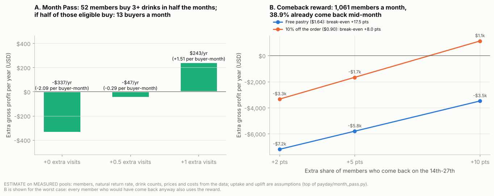

# Project 4: The payday cycle, and what it is realistically worth

**Conclusion for the CEO:** Stories' sales follow the monthly pay cycle. Orders run **5% above
normal from the 28th to the 7th** and **4% below normal from the 14th to the 27th**, in every
month, every branch, and for members and walk-ins alike. The dip is worth **about $5.5k gross
profit a year** at most. What to do:

1. **Move promotion money into the mid-month dip** (14th-27th) and stop spending it at the start
   of the month, when customers come anyway. No new cost.
2. **Do not launch a Month Pass.** Sized on the members who actually exist in the data, only
   **about 13 people a month** would buy one, and it earns **between -$0.5k and +$0.4k a year**.
3. **Test a mid-month comeback reward** (10% off, valid 14th-27th, given to members who visit on
   the 28th-7th) on a random half of those members for 3 months. Worst-case test cost **$557**;
   it pays only if it brings back **4-8 more members out of every 100**, and the test can see an
   effect of 4.8. If it works: **up to about +$3.3k a year**. If not: stop.

> **MEASURED** = computed from the Jan-Jun 2026 transaction file. **DESIGN** = a choice we make.
> **ASSUMPTION** = an unknown shown as a range. Evidence table in section 6.

---

## 1. The finding: a monthly cycle in visits (measured)

Code: [`payday/payday_cycle.py`](../payday/payday_cycle.py). Each day is compared with the same
weekday within ±21 days (so weekdays and the growth trend cancel), public holidays excluded.

| Part of the month | Orders vs a normal day |
|---|---|
| **28th-7th** (just paid) | **+5.1%** |
| 8th-13th | about normal |
| **14th-27th** (before payday) | **-4.1%** |

**It holds everywhere** ([`payday_robustness.csv`](../outputs/payday/tables/payday_robustness.csv)):

| Scope | Gap between the busy and quiet parts of the month |
|---|---|
| Each month, Jan-Jun | +5.1, +16.8, +14.9, +9.9, +6.3, +1.4 points (positive in all 6) |
| Garden / Harbour / Uptown | +8.5 / +10.6 / +6.9 points |
| Members / walk-ins | +9.7 / +8.1 points |
| Statistical check | p < 0.001 (5,000 random reshuffles of the days) |

**Ticket size does not change** ($8.98 vs $9.04, p = 0.84): the cycle is in **how many people
come**, not how much they spend.

**Why "payday":** the timing matches salaries paid around the end of the month. I found no
official source for Lebanese pay dates, so payday is the most likely explanation, not a proven
one. The cycle itself is measured.

**How much money the dip represents:** the 14th-27th days earn **$36.8 less gross profit per
day** than normal; over a year that is **about $5.5k**
([`payday_dip_value.csv`](../outputs/payday/tables/payday_dip_value.csv)). No offer can recover more
than this from the dip, and any offer also costs money on customers who would come anyway.

## 2. Action 1: time promotions to the dip (no new cost)

The Harbour 15% promo of March-May changed nothing (Project 1, `evidence_checks.csv`), and
promotions at the start of the month reward customers who come anyway. So:

- Put **loyalty double points, combos and the Project 3 morning bundle pushes on the 14th-27th**.
- Plan **staff and stock for the 28th-7th**, when visits run 5% above normal.
- Cost: none beyond the promotions Stories would run anyway.

## 3. Who actually exists to sell to (measured)

Code: [`payday/month_pass.py`](../payday/month_pass.py). Table:
[`month_pass_members.csv`](../outputs/payday/tables/month_pass_members.csv).

| | |
|---|---|
| Members (customer IDs) | 3,494 |
| Median member | **1 visit a month** |
| Member-months with 0 / 1 / 2 / 3 / 4+ drinks | 49% / 27% / 14% / 6% / **3.5%** |
| Members with 3+ drinks in a given month | 229-425, but **different people each month** |
| Members with 3+ drinks **in at least half of the months** | **52** |
| Members **averaging** 3+ drinks a month | **2** |
| Members visiting on the 28th-7th (each cycle) | **about 1,061** |
| ...of whom already come back on the 14th-27th | **38.9%** (35.2-44.6% by cycle) |

A 4-drink pass only suits someone who already buys 3-4 drinks a month. That is 52 people, not
hundreds. The much larger group is the ~1,061 members who visit right after payday.

## 4. Option A: Month Pass. Not worth launching

**Design:** 4 drinks for the price of 3.5 = **$18.05** (average drink $5.16, MEASURED), sold on
the 28th-7th, free pastry for a mid-month redemption.

**How it is sized (no guessed buyer counts):**
- Buyers come only from the **52-member pool**, and only in the months they really bought 3+
  drinks: **26.8 eligible a month**. Uptake 25 / 50 / 75% of those (ASSUMPTION) = **7 / 13 / 20
  buyers a month**.
- Profit per buyer uses **their own measured drink counts** (3.48 a month on average; 36% of
  those months already had 4+ drinks). So the discount given on drinks they would have bought
  anyway is measured.
- Cautious: all 4 pass drinks are assumed used (no profit from unused drinks) and the pastry is
  always given.

| Extra visits per buyer a month (ASSUMPTION) | Profit change per buyer-month | **Gross profit a year** (7 / 13 / 20 buyers) |
|---|---|---|
| 0 (habits unchanged) | -$2.09 | **-$168 / -$337 / -$505** |
| 0.5 | -$0.29 | **-$23 / -$47 / -$70** |
| 1.0 | +$1.51 | **+$122 / +$243 / +$365** |

Break-even: **0.59 extra visits per buyer a month**
([`month_pass_option_a.csv`](../outputs/payday/tables/month_pass_option_a.csv),
[`month_pass_unit_economics.csv`](../outputs/payday/tables/month_pass_unit_economics.csv)).

**Verdict:** even in the best case it earns a few hundred dollars a year, and a pool of 52 is too
small to test properly. **Drop it.** (The first version of this project assumed 61-264 buyers a
month and up to +$11.7k a year; the data does not support those numbers.)

## 5. Option B: mid-month comeback reward. Worth a cheap test

**Design:** every member who visits on the 28th-7th automatically gets a reward valid on the
14th-27th. Two rewards compared: a **free pastry** (cost $1.64) and **10% off the order** (cost
$0.90 = 10% of the average member ticket of $9.00).

**The catch, measured:** 38.9% of these members come back mid-month anyway, so most rewards go to
people who were coming regardless. Each extra returning member brings $5.28 gross profit (MEASURED)
minus the reward.

| Reward | Natural returners who use it (ASSUMPTION) | Break-even uplift | Gross profit a year at +2 / +5 / +10 points |
|---|---|---|---|
| Free pastry | all | +17.5 pts | -$7.2k / -$5.8k / -$3.5k |
| Free pastry | half | +8.8 pts | -$3.1k / -$1.7k / +$0.6k |
| **10% off** | all | **+8.0 pts** | -$3.3k / -$1.7k / **+$1.1k** |
| **10% off** | half | **+4.0 pts** | -$1.1k / +$0.6k / **+$3.3k** |

([`comeback_option_b.csv`](../outputs/payday/tables/comeback_option_b.csv),
[`comeback_base.csv`](../outputs/payday/tables/comeback_base.csv)).

**Read:** the free pastry is too expensive. The 10% reward pays only if it lifts the mid-month
return rate by 4-8 points (from 38.9% to about 43-47%). Nobody knows if it will, so it is tested.

**The test** ([`payday_offer_tests.csv`](../outputs/payday/tables/payday_offer_tests.csv)): members have
IDs, so give the reward to a **random half** of the 28th-7th visitors and compare who comes back
on the 14th-27th. Because the split is random, any difference is caused by the reward.

| Length | Members per half | Smallest effect it can see | Worst-case cost |
|---|---|---|---|
| 1 cycle | 530 | 8.4 pts | $186 |
| **3 cycles** | **1,592** | **4.8 pts** | **$557** |

Worst case = no one extra comes back and every natural returner uses the 10%. **Decision after 3
cycles:** if the rewarded half earns more mid-month gross profit per member than the other half,
after paying for the rewards → roll out (about +$1k-3k a year). Otherwise → stop, having spent at
most $557.

## 6. Evidence table

| Claim | Type | Source |
|---|---|---|
| +5.1% on the 28th-7th, -4.1% on the 14th-27th | MEASURED | `payday_by_day_of_month.csv`, `payday_robustness.csv` |
| Holds in all 6 months, 3 branches, members and walk-ins | MEASURED | `payday_robustness.csv` |
| Ticket size unchanged | MEASURED | `payday_robustness.csv` |
| Dip worth ~$5.5k gross profit a year | MEASURED | `payday_dip_value.csv` |
| Holidays excluded | SOURCED | HolidayDB 2026 (see `docs/3_morning_sources.md`) |
| 52-member pass pool, 26.8 eligible a month, their drink counts | MEASURED | `month_pass_members.csv`, `month_pass_unit_economics.csv` |
| Drink price and cost, pastry cost, $5.28 per member visit, $2.41 food profit per visit | MEASURED | `month_pass_unit_economics.csv` |
| 1,061 post-payday members, 38.9% natural return | MEASURED | `comeback_base.csv` |
| Pass design, reward design, 3-cycle test | DESIGN | `payday/month_pass.py` |
| Pass uptake, extra visits, reward uplift, redemption by natural returners | ASSUMPTION (ranges) | `month_pass_option_a.csv`, `comeback_option_b.csv` |
| Test sees 4.8 pts in 3 cycles; worst-case cost $557 | MEASURED from history | `payday_offer_tests.csv` |

## 7. Limits and approaches rejected

- **No official pay dates found**: the cycle is measured, the payday explanation is not.
- **June is the weakest month for the cycle** (+1.4 points); watch whether it fades.
- **Gross profit only**: no labour or overhead in the data.
- **Walk-ins (36.5% of orders) can't be targeted**: they have no ID, so they only benefit from
  Action 1.
- **Rejected: Month Pass**, too few regular buyers (section 4). **Unlimited coffee
  subscription**: only 2 members average 3+ drinks a month. **Discounts at the start of the
  month**: they reward visits that happen anyway. **Free-pastry reward**: needs +17.5 points.
