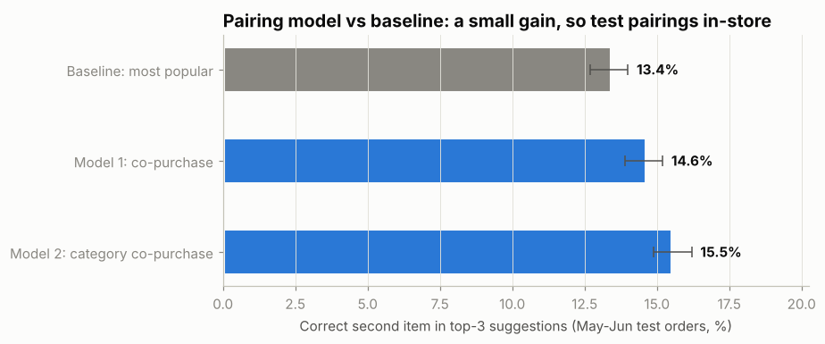
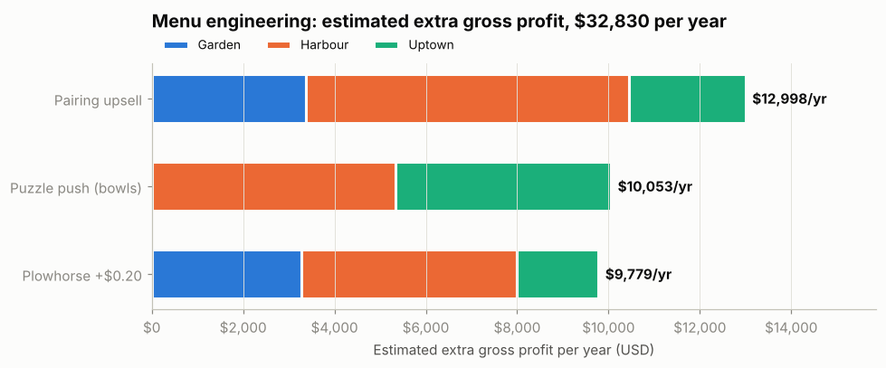

# Project 1: Menu Engineering per Branch

**Conclusion for the CEO:** run menu engineering *per branch*, not chain-wide. Push the Stars,
pair the low-profit best-sellers with them, rebrand the high-profit items nobody orders, and
merge the dead weight. Estimated extra gross profit: **about $32,800 a year**, with no new
customers needed. Prove it first with an 8-week test at Harbour.

> **Measured** = computed directly from the Jan-Jun 2026 transaction file (51,045 lines,
> 33,887 orders after removing 132 duplicate rows).
> **Estimated** = a measured input multiplied by a stated assumption. Every estimate below
> names its assumption.

---

## 1. The problem (measured)

| | Garden | Harbour | Uptown | Chain |
|---|---|---|---|---|
| Orders (6 months) | 11,163 | 16,334 | 6,390 | 33,887 |
| Gross profit per order | $4.18 | $5.97 | $5.45 | $5.28 |
| Orders with only **one item** | 53.3% | 53.9% | 54.5% | **53.8%** |
| Average profit per item sold | $2.62 | $3.75 | $3.43 | $3.32 |

- **More than half of all orders contain a single item.** A one-item order earns **$3.48**;
  a two-item order earns **$7.04**.
- **Profit per item varies more than 5x across the menu**: from about $1.24 (still water) to
  over $6 (bowls), yet the menu treats them all the same.
- **Each branch has different economics.** Garden pays about 49% more than Uptown for the
  same products, so an item that is a Star at Harbour can be a weak seller at Garden.
  8 items change class between branches (section 3).

## 2. Method

Standard menu engineering (Kasavana & Smith), applied separately to each branch:

- **Popular** if the item's share of units sold is at least 70% of an equal share:
  0.70 x (1 / 45 items) = **1.56%**.
- **Profitable** if its gross profit per unit is at least the branch's average
  (Garden **$2.62**, Harbour **$3.75**, Uptown **$3.43**).

| | Profitable | Not profitable |
|---|---|---|
| **Popular** | ⭐ **Star**: push | 🐴 **Plowhorse**: pair / reprice |
| **Not popular** | 🧩 **Puzzle**: rebrand | 🐕 **Dog**: merge / replace |

Why gross profit per unit and not margin %: margin % misleads. Mint Tea has an ~81% margin
but earns only ~$3 per cup and rarely sells; Iced Matcha earns more dollars per sale and
sells about 4x more. The business banks dollars, not percentages.

Code: [`menu_engineering/menu_matrix.py`](../menu_engineering/menu_matrix.py).

## 3. Results per branch (measured)

| Share of gross profit | Garden | Harbour | Uptown |
|---|---|---|---|
| ⭐ Stars | 54.7% (19 items) | 55.0% (19) | 57.5% (19) |
| 🐴 Plowhorses | 35.5% (18) | 34.4% (18) | 32.8% (18) |
| 🧩 Puzzles | 8.3% (6) | 8.0% (5) | 6.4% (4) |
| 🐕 Dogs | 1.5% (2) | 2.6% (3) | 3.3% (4) |

**8 items change class between branches**, so one chain-wide decision would be wrong
somewhere ([`class_differences.csv`](../outputs/tables/class_differences.csv)):

| Item | Garden | Harbour | Uptown |
|---|---|---|---|
| Tiramisu Cup | Plowhorse | **Star** | **Star** |
| Cheesecake Slice | Plowhorse | **Star** | **Star** |
| Tuna Sandwich | Puzzle | Puzzle | **Star** |
| Lemonade | **Star** | Plowhorse | Plowhorse |
| Peach Iced Tea | **Star** | Plowhorse | Plowhorse |
| Fresh Orange Juice | **Star** | **Star** | Plowhorse |
| Mint Tea | Puzzle | Dog | Dog |
| Blueberry Muffin | Plowhorse | Plowhorse | Dog |

Why: Garden's product costs are ~49% above Uptown's for the same items while its prices are
only ~4% higher, which pushes its desserts down into Plowhorses. Uptown sells
sandwiches and wraps 1.3-1.5x more than the chain average, which lifts Tuna Sandwich into a Star.

## 4. Actions

Full list per branch and item: [`outputs/tables/menu_actions.csv`](../outputs/tables/menu_actions.csv).

**⭐ Push the Stars (all branches):** Iced Matcha, Iced Latte, Classic Matcha, Cold Brew,
Strawberry Matcha, sandwiches and wraps. Top of the menu board, lead every pairing, never discount.

**🐴 Pair and reprice the Plowhorses:** croissants, cookies, brownies, cappuccino, water.
Pair each with a Star (below) and test **+$0.20**.

**🧩 Rebrand the Puzzles:** Chicken Salad Bowl and Quinoa Bowl earn **$7.32** per bowl at
Harbour and **$6.45** at Uptown, the most of anything on the menu, but rarely sell. Add photos,
move them to the top-right of the menu, and sell them as a lunch combo (11 am-3 pm).

**🐕 Dogs: merge, don't just delete** (they are only 1.5-3.3% of profit; removing them saves
menu space, not money):
- Merge **Mint Tea + English Breakfast Tea** into one "Tea selection" and suggest Chai Latte.
- Remove **Blueberry Muffin at Uptown only** (a Dog there, a Plowhorse elsewhere). Test 6 weeks.
- **Keep Espresso.** It is the base of the coffee menu; add a double-shot upsell instead.

**Branch-specific moves:**
- **Harbour & Uptown:** push Tiramisu and Cheesecake (Stars there).
- **Uptown:** sandwich-first menu board; Tuna Sandwich is a Star there.
- **Garden:** push Lemonade and Peach Iced Tea. **Fix sourcing before repricing desserts.**

### Four designed pairings (Star + Plowhorse, priced 5% below buying both)

| Pairing | Harbour bundle price | Bundle profit | Extra profit vs Star alone |
|---|---|---|---|
| Iced Latte + Butter Croissant | $8.98 | $6.18 | +$2.22 |
| Cold Brew + Brownie | $10.28 | $6.75 | +$2.50 |
| Chicken Pesto Sandwich + Peach Iced Tea | $15.16 | $8.84 | +$2.72 |
| Quinoa Bowl + Iced Matcha (lunch) | $18.45 | $11.02 | +$3.71 |

All three branches: [`designed_pairings.csv`](../outputs/tables/designed_pairings.csv).

## 5. Can the data pick the pairings for us? (model vs baseline)

We checked before guessing. Code: [`menu_engineering/pairing_model.py`](../menu_engineering/pairing_model.py).

**Lift** (1.0 = bought together exactly as often as chance) is weak everywhere:
the strongest product pair reaches only **1.23**, and bakery + coffee, the classic café
pairing, sits at **0.61-0.66** (customers combine them *less* than chance). The strongest
category pair is Sandwiches + Cold Drinks (**1.00**).

**Recommender test:** trained on Jan-Apr, tested on May-Jun orders it never saw (11,250
predictions from 2-item orders). Given one item, is the other in our top-3 suggestions?

| Method | Top-3 hit rate | 95% interval |
|---|---|---|
| Baseline: 3 most popular items | 13.4% | 12.7-14.0% |
| Model 1: items bought with this item | 14.6% | 13.9-15.2% |
| **Model 2: items bought with this item's category** | **15.5%** | 14.9-16.2% |

**Conclusion:** the model beats the baseline (+16% relative, intervals don't overlap), but
the absolute gain is small. Customers do not yet have strong pairing habits, so **the data
cannot pick winning pairings on its own.** Pairings must be **designed for profit** and
**proven with an in-store A/B test** (section 7). The model is still useful as a
till-suggestion fallback for items not in a designed pairing.

## 6. Money (estimated)

| Lever | Measured input | Assumption | Extra gross profit / year |
|---|---|---|---|
| Pairing upsell | 18,237 single-item orders in 6 months; +$2.84 to +$4.02 profit when a second item is added (by branch) | 10% of single-item orders add a second item | **$12,998** |
| Puzzle push (bowls) | $7.32 (Harbour) / $6.45 (Uptown) profit per bowl | +2 bowls/day at Harbour and Uptown | **$10,053** |
| Plowhorse +$0.20 | 24,448 Plowhorse units in 6 months | sales volume unchanged | **$9,779** |
| **Total** | | | **$32,830** |

Assumptions can be changed at the top of [`menu_engineering/actions.py`](../menu_engineering/actions.py).
Sensitivity: at a 5% upsell conversion the total drops to ~$26k; at 15% it rises to ~$39k.

Not included: fixing Garden's ~49% higher product costs, a separate lever worth an estimated
~$33k a year on its own.

## 7. How to prove it: 8-week A/B test

| | |
|---|---|
| **Test branch** | Harbour (largest, fastest read) |
| **Control branches** | Garden and Uptown, no menu changes |
| **Changes at Harbour only** | New menu layout (Stars first, bowl photos), the 4 pairings, staff suggest a pairing on every single-item order, +$0.20 on Plowhorses |
| **Duration** | 8 weeks (covers 8 Tuesdays and 8 Saturdays) |
| **Main metric** | Gross profit per order (Harbour now **$5.97**). Success = **+5% or more** relative to the change at the control branches |
| **Secondary** | Single-item order share (now 53.9%), bowls per day, Plowhorse units |
| **Guardrails** | Orders/day must not fall more than 3%; Plowhorse units must not fall more than 5% |
| **No other promotions** | during the test (they would blur the result) |

**Staff script:** "Would you like a croissant with your iced latte? It's $8.98 together."

**Decision at week 8:**
- Profit per order up, orders steady: **roll out** to Uptown (sandwich-first version), then
  Garden (after fixing its sourcing).
- Profit up but orders down: keep pairings and menu layout, **drop the price rise**.
- No change: revert. The cost of trying is close to zero.

Re-run the matrix **every quarter per branch**: items move between classes as costs and tastes change.

## 8. Limits and what's missing

- **Gross profit only.** The data has product costs but no labour, rent, waste or energy
  costs, so net profit gains will be smaller than gross.
- **Price response is unknown.** No prices changed during Jan-Jun 2026, so we cannot measure
  how customers react to +$0.20. That is exactly what the guardrails in the test are for.
- **Bundles shift some sales**: a customer who would have bought both items anyway now pays
  5% less. The test's profit-per-order metric captures this.
- **Six months of data** cover winter to early summer only.

## Approaches we rejected

- **Removing every Dog:** they are 1.5-3.3% of profit; removal only pays if customers switch
  to better items, and Espresso is core to the brand.
- **Chain-wide classification only:** it misclassifies 8 items for at least one branch.
- **A complex ML recommender:** the simple co-purchase model already shows the ceiling is low;
  a bigger model would not beat a designed, tested pairing.
- **Discount-led pairing promos:** Harbour's 15% promo (Mar 12-May 19) produced the same growth
  as Garden without a promo (+18.9% each), so discounts alone did not move demand.
