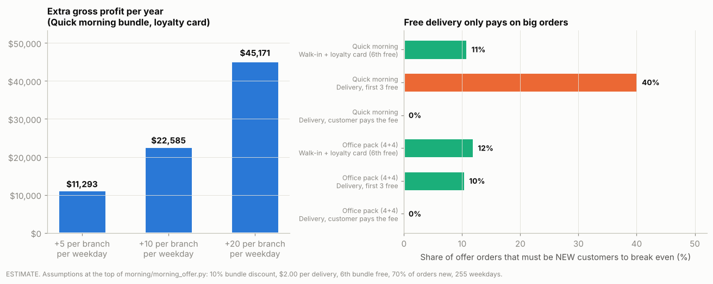

# Project 3: Filling the idle mornings

**Conclusion for the CEO:** Stories' branches run at about 40% of their night pace between
7 and 10 am, with staff and machines already paid for. Launch a **morning bundle with a
loyalty card** ("6th one free") and a **breakfast board**, and offer **delivery only for an
office pack** (4 coffees + 4 pastries). Every 5 extra bundle orders per branch per weekday
is worth about **$11k of gross profit a year** (estimate). The data cannot show that office
workers are the customers, so test it first: 12 weeks at Harbour, measured with a metric we
checked against history.

> **Measured** = computed from the Jan-Jun 2026 transaction file.
> **Estimated** = a measured input times a stated assumption (all assumptions are at the top
> of [`morning/morning_offer.py`](../morning/morning_offer.py)).

---

## 1. The problem: mornings are idle (measured)

Code: [`morning/morning_demand.py`](../morning/morning_demand.py),
[`morning_facts.csv`](../outputs/tables/morning_facts.csv).

| Weekday orders per hour | 7-10 am | 7-11 pm | Morning as % of night |
|---|---|---|---|
| Harbour | 3.59 | 8.72 | 41% |
| Garden | 2.32 | 6.02 | 38% |
| Uptown | 1.33 | 3.47 | 38% |

Mornings are **14.1% of orders and 13.5% of revenue**. The branches are open and staffed,
so extra morning orders mostly cost only the product (no new labour up to the night pace,
see the capacity check in section 5).

## 2. What morning customers do (measured)

| Fact | Morning | Night | What it means |
|---|---|---|---|
| Hot coffee share of items | **23.7%** | 11.2% | Mornings are a hot-coffee moment |
| Takeaway share of orders | **54.0%** | 27.7% | Grab-and-go: a bundle must be fast |
| Morning hot-coffee orders with **no food** | **64.7%** of 1,560 | | The bundle's opening: attach a pastry or breakfast item |
| Members with at least one morning visit | 57.4% | | Most members know the morning |
| Members with 3+ morning visits | **5.2%** | | Mornings are occasional: a loyalty card should build the habit |

**What the data does *not* show: an office crowd.** The morning share of orders is
13.2-14.8% on every day of the week, weekends included, and morning takeaway is 54.0% on
both weekdays and weekends. If offices drove mornings, weekday mornings would stand out;
they don't. "Office workers" is a target to **test**, not a finding.

## 3. The bundles, chosen with the morning menu matrix

The menu matrix run on 7-10 am sales only
([`morning_menu_matrix.csv`](../outputs/tables/morning_menu_matrix.csv)):

| | Morning Stars (popular + profitable) | Most popular (Plowhorses) |
|---|---|---|
| Hot coffee | Vanilla Latte ($3.56), Spanish Latte ($3.76), Caramel Latte ($3.71) | Cappuccino, Flat White, Americano |
| Food | **Egg Sandwich ($4.68), Avocado Toast ($4.76)** | **Butter Croissant** (the most popular morning item) |
| Puzzle | Granola Yoghurt ($4.24, rarely ordered) | |

Menu-engineering rule: pair a Star with a popular item, or two Stars for a premium bundle.
The most-bought morning pair in the data is Flat White + Butter Croissant.

| Bundle | Items | Harbour price | Harbour profit | Uptown profit | Garden profit |
|---|---|---|---|---|---|
| **Quick morning** | Vanilla Latte + Butter Croissant (any hot coffee swap allowed) | $8.60 | $5.74 | $5.12 | $4.10 |
| **Office breakfast** | Spanish Latte + Egg Sandwich | $13.33 | $8.24 | $7.29 | $5.41 |
| **Office pack (4+4)** | 4 hot coffees + 4 pastries | $34.49 | $22.33 | $19.86 | $15.47 |

Prices are 10% below buying the items separately
([`morning_bundles.csv`](../outputs/tables/morning_bundles.csv)). Garden earns less on every
bundle because of its 43% product-cost premium (Project 1, section 7).

**Breakfast board (7-10 am):** lead with Egg Sandwich, Avocado Toast and Granola Yoghurt
(the morning Stars and the morning Puzzle, $4.24-$4.76 profit each) next to the bundles. This
matches Project 1's time-of-day finding: these items are Stars in the morning but not at night.

## 4. Delivery vs a loyalty card: which pays? (estimate)

The risk with any offer is paying a reward to customers who would have come anyway. So the
question per channel is: **what share of offer orders must be genuinely new to break even?**

| Bundle | Channel | Cost per order | Must be new to break even |
|---|---|---|---|
| Quick morning | **Walk-in + loyalty card (6th free)** | $0.54 | **11%** |
| Quick morning | Delivery, first 3 free | $2.00 | **40%** |
| Office pack (4+4) | Walk-in + loyalty card | $2.29 | 12% |
| Office pack (4+4) | **Delivery, first 3 free** | $2.00 | **10%** |

Full table: [`morning_channel_economics.csv`](../outputs/tables/morning_channel_economics.csv).

**So:** the loyalty card is cheap and pays even if most users are existing customers.
**Free delivery on a single coffee is risky** (4 in 10 orders must be new), but on an
**office pack it pays easily**. Rule: **free delivery for the first 3 orders, office pack
minimum ($30+).** After that the customer pays the delivery fee.

Assumptions: $2.00 per delivery (verify with a rider service or aggregator quote), loyalty
reward = product cost of one bundle every 6.

## 5. What it could be worth (estimate)

**Selling the bundle to today's coffee-only morning customers alone is small:** 1,010
coffee-only morning orders in six months; even if 30% add a croissant, that is about
**$900 a year** ([`morning_upsell_ceiling.csv`](../outputs/tables/morning_upsell_ceiling.csv)).
The value has to come from **new** morning orders filling idle hours:

| Extra Quick-morning orders per branch per weekday | Extra gross profit per year (3 branches) | Fits under each branch's night pace? |
|---|---|---|
| +5 | **$11,293** | Yes, all three |
| +10 | **$22,585** | Yes at Harbour and Garden; Uptown slightly above (3.8 vs 3.5 orders/hour) |
| +20 | $45,171 | Only Harbour; Garden and Uptown would need extra morning staff |

Assumptions: 70% of offer orders are new, loyalty card cost included, 255 office weekdays a
year ([`morning_scenarios.csv`](../outputs/tables/morning_scenarios.csv)). For scale: +5 orders
per branch per weekday is about **one extra order every 48 minutes** during 7-10 am.

## 6. How to test it (design checked on history)

| | |
|---|---|
| **Where** | Harbour (most morning orders, so fastest to read) |
| **What** | Quick morning + Office breakfast bundles, breakfast board 7-10 am, loyalty card; office-pack delivery with first 3 free (min. $30) |
| **Control** | Garden and Uptown, no changes |
| **Main metric** | Harbour's **morning share of daily orders** minus the controls' (now 14.4% at Harbour) |
| **Duration** | 12 weeks |
| **Also track** | Loyalty card sign-ups and redemptions; delivery orders and how many come from new customer IDs; bundle profit per morning order |

**Why this metric is trustworthy here:** on Jan-Jun history (no changes made), the weekly
morning-share gap between Harbour and the controls has **no drift** (+0.02 pts per week) and
a before/after test raised 1 false alarm in 10 fake 8-week tests. Over 12 weeks it can detect
a **2.0-point rise** in Harbour's morning share, about **2 extra morning orders a day**
([`morning_test_design.csv`](../outputs/tables/morning_test_design.csv)). That is less than the
+5 per day in the smallest scenario, so a real success would show up. Only 10 fake tests were
possible in six months of data, so the false-alarm estimate is rough; running the test
longer than 12 weeks lowers the risk further.

**Decision at week 12:**
- Morning share up by 2+ points and loyalty redemptions mostly from new or rarely-seen
  members: **roll out** to Garden (after its sourcing fix) and Uptown.
- Up, but delivery orders mostly from existing morning regulars: keep the bundles and loyalty
  card, **drop free delivery**.
- No change: stop. Fallback for Uptown, which gets under 1 order an hour at 7-8 am: open at 9.

## 7. Limits and what's missing

- **No customer type or location.** The file cannot show office workers; the test must.
- **No labour cost.** "Idle" assumes morning staff are already scheduled; extra orders up
  to the night pace need no new staff (assumption to confirm with operations).
- **No delivery data.** The $2.00 delivery cost is an assumption; get a real quote.
- **New vs existing customers:** 37% of orders have no customer ID; the loyalty card itself
  fixes this going forward.

## 8. Approaches rejected

- **Bundle for existing morning customers only:** worth about $900 a year; too small alone.
- **Free delivery on single coffees:** needs 40% of orders to be new to break even.
- **Targeting offices as a proven segment:** the data shows no weekday or office pattern in
  mornings; we test it instead of assuming it.
- **Extending morning staff now:** not needed until extra orders exceed each branch's night
  pace (+10 per weekday at Harbour and Garden still fits).
