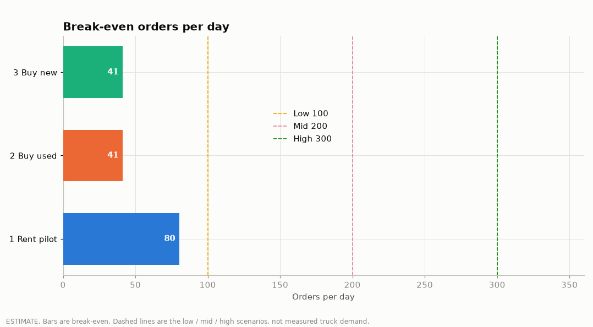
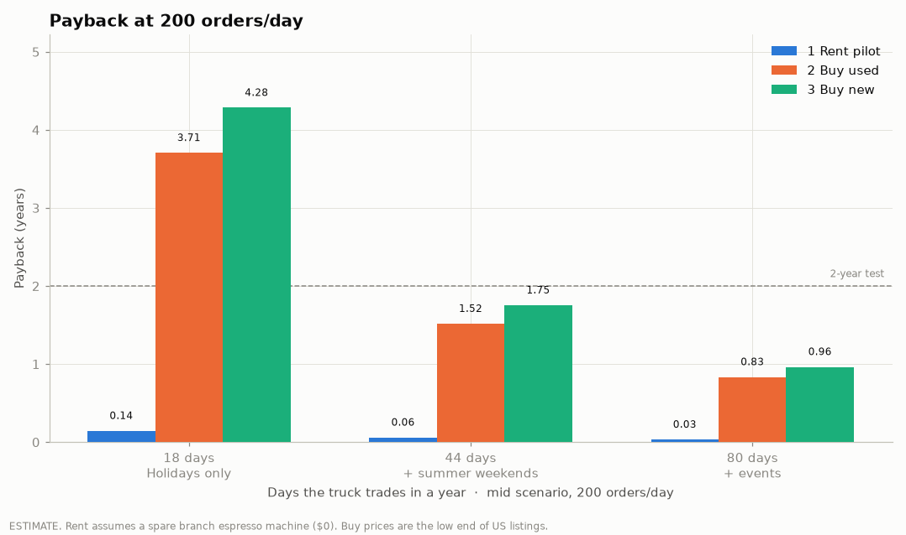

# Project 2: Holiday truck business case

**Conclusion.** Rent a truck first and treat the season as a pilot. Buy only if that pilot beats break-even by enough to pay the trailer back within 2 years and the truck can honestly work at least 44 days a year (about 162 orders/day for a used trailer, about 180 for a new one, at 44 days). Never buy a truck for the holiday dates alone: at 18 days a year, even 300 orders/day misses a 2-year payback.

> **Measured** = computed from `data/raw/stories_transactions.csv` (Jan-Jun 2026, 51,045 lines and 33,887 orders after 132 duplicate rows were removed).
> **Estimated** = a measured input times a stated assumption, or a price taken from a US listing. Sources are in [truck_sources.md](truck_sources.md).

---

## 1. The problem (measured)

People leaving Beirut is the idea. The file only shows what happened inside the three branches (Garden, Harbour, Uptown).

| | Jan-Jun 2026 |
|---|---|
| Orders | 33,887 |
| Revenue | $305,184 |
| Gross profit | $178,994 |
| Items per order | 1.59 |

Holiday test: each day's chain revenue against the average of the **same weekday** on every other day in the six months.

| Holiday | Chain revenue vs a normal same weekday | What the branches did |
|---|---|---|
| Eid al-Fitr, 20-23 Mar | **-$1,030 (-17.2%)** over 4 days | 21 Mar ($911) was the **third-worst day** of the half-year |
| Eid al-Adha, 27-28 May | **+$440 (+13.5%)** over 2 days | No dip. The branches were not empty |

Fitr is a real hole in branch sales. Adha is not. A truck is not a way to "win back" an Adha loss that does not exist in this file. It is a bet that, on some days, the crowd is outside Beirut.

## 2. Where and when

Full rows: [`truck/holiday_calendar.csv`](../truck/holiday_calendar.csv). Rule for every row: **no stop in a place under an evacuation order or active strikes.** Follow official guidance the week you roll. A ceasefire date is not a permit.

2026 context, sourced:

- War from **2 Mar 2026**. A 10-day cessation of hostilities from **16 Apr 2026**. The 17 Apr Reuters explainer says Israeli forces were not required to leave the South.
- Anadolu: for Eid al-Adha, families no longer gathered in southern border villages.
- Annahar (page dated 12 Jun 2026; the English index lists it on 13 Jun): Ehdeniyat skipped 2026, Beiteddine cancelled, Baalbek moving toward postponement, Byblos uncertain, Beirut Holidays moved to **Antelias-Naccache, 16-28 Jul**.

| Window | Days | 2026 call | Include |
|---|---|---|---|
| Eid al-Fitr, 20-23 Mar | 4 | Inside the war. High security risk. | No |
| Easter and Orthodox Easter, 3-6 Apr and 10-13 Apr | 8 | Still before 16 Apr. High security risk. | No |
| Eid al-Adha, 27-28 May | 2 | Do not go to Nabatieh, Tyre, or Baalbek-Hermel. Anadolu. Safer names in the plan are Saida and Chtaura/Zahle, and those have **no traffic source**. | Only the safer names, and only with official guidance |
| Ashoura, 26 Jun | 1 | Mourning period. A sales truck is not appropriate. | No |
| Summer weekends, Jul-Aug Fri-Sun | 27 | Batroun, Byblos, Ehden are assumptions. Ehden's festival is off. | Yes, as a test, low confidence |
| Beirut Holidays, 16-28 Jul | 13 | Moved to Antelias-Naccache. This is the one festival still on. | Yes |
| Assumption, 15 Aug | 1 | Mount Lebanon / North is an assumption. | Yes, if that area is not under an order |
| New Year, Orthodox Christmas, Christmas | 3 | Faraya, Kfardebian, Jounieh, Byblos markets are assumptions. | Yes, if the week is safe |

There is no URL for the idea that southerners still went home for Eid in earlier wars. It is not used as a reason to deploy.

## 3. Truck menu

Sixteen items. No hot kitchen, no freezer, nothing that has to be assembled.

Drinks: Cold Brew, Iced Latte, Iced Matcha, Classic Matcha, Iced Americano, Americano, Cappuccino, Spanish Latte, Lemonade, Peach Iced Tea, Still Water.

Food, pre-packed and ambient: Butter Croissant, Chocolate Cookie, Pistachio Cookie, Brownie, Banana Bread.

Left off, and why: sandwiches, the halloumi wrap, bowls, and soup need a kitchen or a protein cold chain; breakfast items are made to order; cheesecake and tiramisu spoil in a cooler; frozen yoghurt needs a freezer.

Measured mix of these 16 items (units sold in the branches, list price minus list cost, discounts not included):

| | Value | Kind |
|---|---|---|
| Price per item | $4.71 | Measured |
| Unit cost | $1.66 | Measured |
| Profit per item | $3.05 | Measured |
| Margin | 64.7% | Measured |
| Ticket per order | $7.49 | Estimate: price x 1.59 items |
| Product profit per order | $4.85 | Estimate: profit x 1.59 items |

Detail: [`outputs/tables/truck_menu.csv`](../outputs/tables/truck_menu.csv).

## 4. Supply chain

Load at the nearest branch each morning. Cold brew, lemonade, and peach iced tea are batched at the branch the night before. Pastries come from branch stock, already packed. Milk rides in a cooler box. Use a spare branch espresso machine if operations confirms one exists; if it does not, the pilot needs a $5,500 machine and a $1,500 grinder on top of the $1,500 branding. On a multi-day trip, restock from a branch or from a supplier near Saida or Zahle rather than driving back to Beirut mid-service. That restock point is an assumption until someone names the supplier.

## 5. Costs and returns (estimated)

Product profit per order is $4.85. It does not pay staff, fuel, the site, or the vehicle.

Daily cash cost once the truck is owned: 2 staff x $40 + $40 fuel and generator + $50 site fee + $30 misc = **$200**. Rent adds $150 for the vehicle and $40 for a generator: **$390**.

Upfront, using the **low end** of the US ranges (optimistic; Lebanon is not quoted):

| Option | Upfront | What it is |
|---|---|---|
| 1 Rent pilot | $1,500 | Branding and cups. Spare machine assumed at $0. |
| 1 Rent, no spare machine | $8,500 | Same, plus a $5,500 machine and a $1,500 grinder |
| 2 Buy used | $51,300 | $30,000 trailer + $15,000 equipment + $2,500 wrap + $800 permits + $3,000 stock |
| 3 Buy new | $59,299 | HorecaStore 14-ft trailer $49,999 + $3,000 shipping (assumption) + the same wrap, permits, and stock |

Break-even is a daily test. It does not depend on how many days you work.

| Option | Break-even | Low 100 | Mid 200 | High 300 |
|---|---|---|---|---|
| Rent | **80.5 orders/day** | Clears | Clears | Clears |
| Buy used | **41.3 orders/day** | Clears | Clears | Clears |
| Buy new | **41.3 orders/day** | Clears | Clears | Clears |

Clearing break-even is not the buy test. At exactly 41 orders/day the owned truck makes no cash, so it never pays back. Payback at the **mid** case (200 orders/day):

| Option | 18 holiday days | 44 days | 80 days |
|---|---|---|---|
| Rent | 0.14 years (net $10,424) | 0.06 years (net $25,481) | 0.03 years (net $46,330) |
| Buy used | **3.71 years** (net $13,844, year-1 cash -$37,456) | **1.52 years** (net $33,841, year-1 cash -$17,459) | 0.83 years (net $61,530) |
| Buy new | **4.28 years** (net $13,844, year-1 cash -$45,455) | **1.75 years** (net $33,841, year-1 cash -$25,458) | 0.96 years (net $61,530) |

If there is no spare machine, the mid-case rent payback is still inside a year: 0.82 years at 18 days, 0.33 at 44, 0.18 at 80. The pilot survives that. The purchase does not survive an 18-day year.

At 44 days, a used trailer needs about **162 orders/day** and a new one about **180** to pay back within 2 years. Both sit above the 41-order break-even and below the 200-order mid case. At 18 days, 300 orders/day still leaves the used trailer at about 2.3 years and the new one slower.

The 80-day year is an assumption, not a count of sourced dates. Do not buy on the strength of that column.

## 6. Recommendation and the pilot

Rent. Do not buy off this spreadsheet.

Run the pilot on one safe, sourced occasion and one weekend, not a southern Eid convoy:

1. Beirut Holidays at Antelias-Naccache (16-28 Jul), or one Jul-Aug weekend in Batroun or Byblos if Google Maps traffic actually shows a crowd.
2. Eid al-Adha only as a second test, and only in Saida or Chtaura/Zahle, and only if official guidance does not have an evacuation order. Do not use it as the reason to buy. Branch sales did not fall on Adha.

Write down, each day: orders, ticket, and cash cost. Compare them with 80.5 orders/day (rent break-even), $7.49 ticket, $4.85 product profit, and $390 cash cost.

Decision after the pilot:

- Under 80 orders/day: stop. The rent does not cover the day.
- 80 to about 160, and you cannot see 44 real trading days: rent again next season. Do not buy.
- About 162 or more, and a calendar you can defend at 44 days or more: a used trailer can pay back inside 2 years at the mid prices above. Get a Lebanon quote before you sign. The $51,300 figure is the bottom of US ranges, and permits alone are listed up to $17k+.

## 7. Risks

- **Security.** The South stays out. Baalbek stays out while the festival itself is postponing. Ehden and Beiteddine are not festival sites in 2026.
- **Permits.** $800 is the bottom of a US range. A real Lebanese permit stack can erase the buy case.
- **Weather and staff travel.** Two people at $40 a day is an assumption. A long drive plus a slow day loses the rent.
- **Cannibalisation.** Low if the customers are people who are not in Beirut that day. The file cannot see them. Adha is a warning: the branches were fine, so "everyone left" was not true in May.
- **Data limits.** No labour, rent, fuel, or municipality cost in the transaction file. Equipment prices are US web listings. Orders per day (100 / 200 / 300) are scenarios, not a forecast. The 1.59 items per order is the branch habit, applied to a shorter menu.

## 8. Measured vs estimated

| Figure | Kind |
|---|---|
| 33,887 orders, $305,184 revenue, $178,994 gross profit, 1.59 items/order | Measured |
| Eid al-Fitr -$1,030 (-17.2%); 21 Mar third-worst day | Measured |
| Eid al-Adha +$440 (+13.5%) | Measured |
| Truck-menu price $4.71, profit $3.05, margin 64.7% | Measured |
| Ticket $7.49 and product profit $4.85 per order | Estimate (x 1.59) |
| 100 / 200 / 300 orders per day | Estimate |
| 18 and 44 days | Counted from the holiday calendar, before dropping unsafe 2026 dates |
| 80 days | Estimate. Not a sourced count |
| $200 and $390 daily cost, $40 wages, rent rates | Estimate. Verify locally |
| $1,500 / $51,300 / $59,299 upfront | Estimate. US list prices, low end, plus a $3,000 shipping assumption |
| Break-even 80.5 and 41.3 orders/day, and every payback year | Estimate |

## 9. Approaches rejected

- Buying a trailer so it can work the holiday list and then sit. At 18 days the payback is 3.7 years (used) or 4.3 years (new) even at 200 orders/day.
- Sending the truck to Nabatieh, Tyre, or other southern border villages for Eid. Anadolu says families were not gathering there, and the April deal did not pull forces out of the South.
- Baalbek-Hermel while Baalbek's own festival is postponing.
- Ehden or Beiteddine as festival stops in 2026. Annahar: Ehdeniyat is absent, Beiteddine cancelled.
- Trading on Ashoura.
- Easter 2026. Those dates sit inside the war, before 16 Apr.
